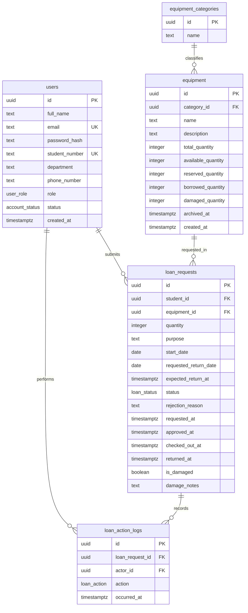

# BorrowHub MVP — تصميم قاعدة البيانات

## نظرة عامة ومصادر التحليل

المصدر الأساسي هو [PRD v1.0.0](PRD.md)، خصوصًا FR-001–025 وNFR-002 وNFR-008 و§16 و§18 و§23 وDEC-01–05. روجعت [تدفقات المستخدم](user-flow.md)، [نموذج المجال](diagrams/domain-model.md)، [حالات الاستخدام](diagrams/use-case.md) و[التتابع](diagrams/sequence.md). الملف المطلوب `docs/diagrams/sequence-diagrams.md` غير موجود؛ استُخدم `sequence.md` المتاح. المقصود بـ`user-flow\.md` هو الملف المتاح `user-flow.md`.

هذا **تصميم تقني مقترح** لخمسة جداول، وليس تعديلًا للمتطلبات ولا مخططًا تنفيذيًا جاهزًا قبل حسم الأسئلة أدناه. PostgreSQL اختيار تقني لتحديد الأنواع وعبارات CHECK، وليس محركًا مفروضًا في PRD. UUID يتوافق مع §16؛ طريقة توليده تترك للتنفيذ. `timestamptz` لتخزين اللحظات و`date` للفترة المطلوبة؛ المنطقة الزمنية التشغيلية تحتاج قرارًا مستقلاً.

## الكيانات وأعمدتها

جميع المفاتيح الأساسية `id` من نوع `uuid` وإلزامية. كل عمود بلا `not null` في [DBML](database.dbml) يقبل NULL صراحةً. النصوص `text` تجنب حدود طول غير موثقة؛ الفحص غير الفارغ يطبق `btrim`، والتحقق من أنواع المحارف والمسافات الأخرى مسؤولية التحقق من المدخلات.

### users — الحساب وبيانات الطالب

يوحد الطالب والمسؤول في حساب ذي دور، دون جداول أدوار وصلاحيات لا يحتاجها الدوران الثابتان. الاسم والبريد وبيانات الطالب مطلوبة في FR-001؛ `password_hash` يحقق SEC-01. لا تخزن كلمة المرور الأصلية.

| الأعمدة | النوع | الإلزام والتفسير |
|---|---|---|
| id | uuid PK | هوية الحساب |
| full_name | text | NOT NULL، غير فارغ |
| email | text UNIQUE | NOT NULL، غير فارغ؛ البريد الجامعي يتحقق وفق نطاقات معتمدة لم تحدد بعد |
| password_hash | text | NOT NULL، غير فارغ؛ salted bcrypt وفق SEC-01 |
| student_number | text UNIQUE | إلزامي غير فارغ للطالب؛ اختياري للمسؤول؛ يحفظ الأصفار البادئة |
| department, phone_number | text | إلزاميان غير فارغين للطالب؛ اختياريان للمسؤول |
| role | user_role | NOT NULL؛ STUDENT أو ADMIN؛ التسجيل العام ينشئ STUDENT فقط |
| status | account_status | NOT NULL؛ PENDING_APPROVAL افتراضيًا، ACTIVE أو REJECTED |
| created_at | timestamptz | NOT NULL؛ وقت إنشاء الحساب |

الفهرس `(role, status)` يخدم مراجعة التسجيلات. UNIQUE على البريد والرقم الجامعي مصدره §16 وEC-03؛ PostgreSQL يسمح بأكثر من NULL للرقم في حسابات المسؤولين. لا توجد قاعدة تفرد للهاتف. القسم نص لأن المتطلبات لا تحدد إدارة دليل أقسام أو صلاحيات مستودعات متعددة.

### equipment_categories — فئات المعدات

يحقق CRUD الفئات المذكور في PRD §14 ويمنع تكرار وصف الفئة في المعدات.

| الأعمدة | النوع | الإلزام والتفسير |
|---|---|---|
| id | uuid PK | هوية الفئة |
| name | text | NOT NULL، غير فارغ؛ لا يفترض تفرد الاسم |

الفئة الواحدة لكل صنف قرار تمثيل تقني مستند إلى حقل category المفرد في §16، وليس دعمًا لتصنيفات متعددة مخترعة.

### equipment — الكتالوج والمخزون التجميعي

يمثل **صنفًا أو نموذجًا**؛ لا يمثل قطعة مرقمة. يبقى المخزون في الصف نفسه، فلا حاجة لجدول مخزون بعلاقة 1:1 بلا دورة حياة مستقلة.

| الأعمدة | النوع | الإلزام والتفسير |
|---|---|---|
| id | uuid PK | هوية الصنف |
| category_id | uuid FK | NOT NULL؛ equipment_categories.id |
| name, description | text | NOT NULL؛ الاسم غير فارغ، لا يفرض حد أدنى للوصف |
| total_quantity | integer | NOT NULL، ≥0؛ معنى الإجمالي بعد التلف غير محسوم |
| available_quantity | integer | NOT NULL، ≥0؛ وحدات متاحة |
| reserved_quantity | integer | NOT NULL، ≥0؛ وحدات خصصت بالموافقة ولم تسلم |
| borrowed_quantity | integer | NOT NULL، ≥0؛ وحدات سلمت ولم ترجع |
| damaged_quantity | integer | NOT NULL، ≥0؛ وحدات تالفة خارج المتاح |
| archived_at | timestamptz | اختياري؛ NULL يعني غير مؤرشف |
| created_at | timestamptz | NOT NULL؛ وقت إنشاء الصنف |

فهرس category_id يخدم الربط والتصفية. الكميات تهيأ صراحة عند الإنشاء؛ لا يفترض أن جميع الأصناف تبدأ برصيد صفر. `archived_at` تمثيل تقني للأرشفة FR-006؛ أثر الأرشفة على الطلبات القائمة يحتاج حسمًا.

### loan_requests — الطلب والإعارة

صف واحد يستمر من التقديم إلى الإغلاق. وحدة واحدة وصنف واحد، لذلك لا يحتاج `loan_items` أو جدول حجز منفصل أو جدول إرجاع.

| الأعمدة | النوع | الإلزام والتفسير |
|---|---|---|
| id | uuid PK | هوية الطلب |
| student_id | uuid FK | NOT NULL؛ users.id، وليس الرقم الجامعي النصي |
| equipment_id | uuid FK | NOT NULL؛ equipment.id |
| quantity | integer | NOT NULL، DEFAULT 1، CHECK =1 وفق FR-014 |
| purpose | text | NOT NULL، غير فارغ وفق FR-013 |
| start_date | date | NOT NULL؛ تاريخ البدء المطلوب |
| requested_return_date | date | NOT NULL؛ نهاية الفترة المطلوبة، لا تتجاوز start_date +10 |
| expected_return_at | timestamptz | اختياري قبل التسليم، إلزامي للمستلم والمتأخر والمرتجع؛ الموعد التشغيلي |
| status | loan_status | NOT NULL؛ يبدأ PENDING_REVIEW |
| rejection_reason | text | اختياري، لكنه إلزامي وغير فارغ في REJECTED |
| requested_at | timestamptz | NOT NULL؛ وقت تقديم الطلب FR-020؛ يغني عن created_at مكرر |
| approved_at | timestamptz | اختياري، إلزامي من APPROVED وما بعدها |
| checked_out_at | timestamptz | اختياري، إلزامي بعد التسليم |
| returned_at | timestamptz | اختياري؛ إلزامي حصريًا في RETURNED |
| is_damaged | boolean | NULL قبل الإرجاع؛ true أو false عند إغلاق الإعارة |
| damage_notes | text | اختياري وفق FR-022؛ لا يوضع إلا عند is_damaged=true |

فصل نهاية الفترة المطلوبة عن لحظة الاستحقاق يحفظ اختيار الطالب ويدعم FR-020 دون افتراض أن الموعد يعاد حسابه من التسليم؛ إنه قرار تقني لمعالجة غموض المصدر، وليس إثباتًا لموعدين تجاريين مستقلين. الفحص `start_date <= requested_return_date <= start_date +10` يثبت السقف المؤكد، ولا يقرر منع طلب اليوم نفسه أو طريقة العد الشامل. لا يوجد CHECK يربط الموعد التشغيلي ببداية معينة قبل حسم Q02.

الحالات المدعومة: PENDING_REVIEW، APPROVED، REJECTED، CANCELLED، EXPIRED، CHECKED_OUT، OVERDUE، RETURNED. أضيف CANCELLED وEXPIRED المنصوص عليهما وظيفيًا رغم غيابهما من §16. **وجود OVERDUE في enum لا يحسم تخزينه**: يمكن أن يبقى CHECKED_OUT ويعرض وسمًا مشتقًا، أو يصبح OVERDUE بعد حسم الحصة والإرجاع. `RETURNED + is_damaged=true` اقتراح يتبع AC-05؛ لا تضاف DAMAGED كحالة إعارة نهائية قبل حسم تعارض F-04.

الفهارس `(student_id,status)` للحصة وقائمة الطالب، equipment_id للربط ومراجعة المخزون، `(status,requested_at)` لطابور المراجعة، `(status,start_date)` لمرشحي انتهاء الحجز، `(status,expected_return_at)` للمتأخرين. لا يتكرر فهرس PK أو UNIQUE تلقائي الإنشاء.

### loan_action_logs — المسؤولية عن الإجراءات

يحقق NFR-008 بسجل أحداث مستقل؛ لا نخزن approved_by مكررًا في الطلب لأن مسؤول الموافقة يستخرج من الحدث.

| الأعمدة | النوع | الإلزام والتفسير |
|---|---|---|
| id | uuid PK | هوية الحدث |
| loan_request_id | uuid FK | NOT NULL؛ loan_requests.id |
| actor_id | uuid FK | NOT NULL؛ users.id للمسؤول الذي نفذ الإجراء |
| action | loan_action | NOT NULL؛ APPROVED، CHECKED_OUT، RETURNED أو DAMAGED |
| occurred_at | timestamptz | NOT NULL؛ لحظة الإجراء |

الإرجاع التالف يسجل حدثي RETURNED وDAMAGED في المعاملة نفسها وبالمسؤول والوقت نفسيهما؛ تمثيل تقني لتوثيق الإرجاع والتلف. السجل append-only بصلاحيات قاعدة البيانات، لا يعتمد على واجهة المستخدم. الفهارس `(loan_request_id,occurred_at)` وactor_id. لا يفرض UNIQUE للأحداث؛ منع إعادة تسجيل العملية يتم بانتقال حالة شرطي داخل المعاملة. توقيت الحدث يطابق حقل المرحلة المقابل في الطلب، وهذا تكرار مقصود بين حالة حالية وسجل مساءلة، تضبطه المعاملة.

## Mermaid ERD

NULL وقيود CHECK موثقة أعلاه وفي DBML؛ Mermaid يوضح الهيكل والمفاتيح والتعددية، ولا يعبر عن كل قيد شرطي.

## مرجع DBML والعلاقات

المصدر الكامل القابل للصق في dbdiagram.io هو [database.dbml](database.dbml). الصياغة تتبع [مرجع DBML الرسمي](https://dbml.dbdiagram.io/docs/) و[مرجع Mermaid ERD الرسمي](https://mermaid.js.org/syntax/entityRelationshipDiagram.html).

| العلاقة | التعددية | المعنى |
|---|---|---|
| users → loan_requests | 1 إلى 0..N | كل طلب لطالب واحد؛ الطالب قد لا يملك طلبات، والحد 2 للنشط فقط لا للتاريخ كله |
| equipment_categories → equipment | 1 إلى 0..N | كل صنف ينتمي لفئة واحدة؛ الفئة يمكن أن تبدأ فارغة |
| equipment → loan_requests | 1 إلى 0..N | كل طلب لصنف واحد؛ يمكن طلب الصنف عدة مرات عبر الزمن |
| loan_requests → loan_action_logs | 1 إلى 0..N | كل حدث لطلب واحد؛ الطلب الجديد لا يملك أحداثًا إدارية بعد |
| users → loan_action_logs | 1 إلى 0..N | كل حدث لمسؤول واحد؛ المسؤول يمكن ألا يكون نفذ إجراء بعد |

لا توجد علاقة 1:1 أو N:M تتطلب جدول ربط إضافيًا. العلاقة التاريخية بين الطلاب والمعدات تحلها loan_requests نفسها وتحمل الغرض والفترة والحالة. علاقات الرسم مع users مقيدة بالدور عند الكتابة؛ FK يثبت وجود الحساب فقط.

جميع FKs تستخدم RESTRICT للحذف والتعديل كقرار تقني يحمي التاريخ. لا حذف متسلسل للطلاب أو المعدات أو السجلات. يمكن حذف فئة غير مرتبطة؛ حذف المرتبطة يحتاج إعادة تصنيف صريحة أو قرار أعمال. سياسة الاحتفاظ/إخفاء الهوية لم تحدد، فلا يعني RESTRICT الاحتفاظ الأبدي قانونيًا.

## قواعد السلامة ودعم MVP

| القاعدة | المصدر | مكان الضبط |
|---|---|---|
| تفرد البريد والرقم الجامعي | §16، EC-03 | UNIQUE؛ سياسة canonicalization قبل التخزين غير محسومة |
| اكتمال بيانات الطالب وحفظ hash | FR-001، SEC-01 | NOT NULL وCHECK شرطي؛ صيغة البريد والهاتف والتحقق الجامعي عند الإدخال |
| وحدة واحدة وغرض غير فارغ وسقف 10 أيام | FR-012–014 | CHECK؛ حد اليوم وصفر أيام يحتاجان توضيحًا |
| الطالب ACTIVE، المسؤول لا يستعير | FR-003، DEC-05 | فحص دور وحالة الحساب داخل معاملة التقديم |
| طلبان نشطان كحد أقصى | FR-014، DEC-01 | قفل صف الطالب ثم عد الحالات وإدراج الطلب في معاملة واحدة؛ ليس CHECK عاديًا |
| الحجز فور الموافقة، لا عند التقديم | FR-008، AC-02 | تغيير الحالة والأرصدة ذريًا مع فحص الرصيد |
| رفض مع سبب وإلغاء ذاتي للمعلق فقط | FR-016–017 | CHECK للسبب؛ انتقال شرطي مع تحقق الملكية والدور |
| انتهاء خلال 48 ساعة من تاريخ البدء | FR-018، DEC-04 | تقييم داخلي ومعاملة تحرير؛ تحويل التاريخ للحظة يحتاج المنطقة الزمنية وحد اليوم |
| التسليم والإرجاع مرة واحدة | FR-019–022 | قفل/تحديث شرطي للحالة مع الأرصدة والتوقيت والتدقيق |
| التلف لا يعيد المتاح | FR-010، AC-05 | borrowed−1 وdamaged+1؛ أثر total معلّق |
| كشف التأخر دون منع تلقائي | FR-023–025 | تقييم expected_return_at؛ لا غرامات أو قيد حظر بسبب التأخر |
| معرفة من وافق وسلم وأرجع/سجل التلف | NFR-008 | أحداث مرتبطة بحساب المسؤول في المعاملة نفسها |
| حماية بيانات الطالب | SEC-03، NFR-006 | صلاحيات قراءة/كتابة وملكية السجل؛ الرسم وحده لا يوفر RBAC |

الانتقالات المؤكدة: PENDING_REVIEW→APPROVED/REJECTED/CANCELLED؛ APPROVED→CHECKED_OUT/EXPIRED؛ CHECKED_OUT→RETURNED. مسار OVERDUE وإلغاء المعتمد يدويًا غير محسومين. CHECK للحالة الحالية لا يمنع قفز الحالات؛ يلزم ضبط الانتقالات عند الكتابة.

الكميات والتقارير والاتصال بالطالب تأتي من الجداول القائمة. لا جداول للمتأخرين أو الإشعارات أو التحليلات أو القطع المسلسلة أو الغرامات أو الصيانة أو تكلفة التلف. معدلات التلف يمكن حسابها من الإرجاعات؛ نسبة المخزون التالف تحتاج تعريف total. التقارير الفصلية تحتاج حدود الفصل الجامعي ولا تبرر جدول فصل دون تعريفه.

## التطبيع والشرح بالعربية

التصميم في 3NF للأوصاف والعلاقات: بيانات الشخص في users، اسم الفئة في equipment_categories، وصف الصنف في equipment، تفاصيل الطلب في loan_requests، وهوية منفذ الحدث في loan_action_logs. لا تنسخ بيانات التواصل أو اسم المعدة داخل الطلب؛ يستخدم FK لربطها. تتغير بيانات التواصل الحالية دون تعديل سجل الطلب؛ لا توجد متطلبات snapshots تاريخية.

**الاستثناء المقصود من عدم التكرار** هو أرصدة المخزون التجميعية المفروضة في FR-007–008، ويمكن اشتقاق المحجوز والمستعار من الطلبات. إبقاؤها يسمح بحجز آخر وحدة بتحديث ذري؛ لا يصح وصفها بأنها خالية تمامًا من التكرار. أيضًا يحتفظ الطلب بتوقيت مراحله ويسجل الحدث توقيت المساءلة. المطابقة والمعاملة الذرية تمنع الاختلاف، ولا تخزن مدة أو أيام تأخير أو عداد طلبات نشطة يمكن اشتقاقها.

المفتاح الأساسي يحدد الصف؛ المفتاح الأجنبي يمنع طلبًا بلا طالب أو معدة وحدثًا بلا طلب أو مسؤول. التعددية 1:N تعني السماح بتاريخ متعدد مع انتماء كل صف تابع لأصل واحد، ولا تلغي الحد التجاري للطلبات النشطة. التفاصيل الشرطية للحساب والعودة تعطي NULL معنى محددًا بدلاً من قيم وهمية.

## الأسئلة المفتوحة

راجع [مراجعة التصميم](database-review.md) للآثار والمراجع. يجب حسم:

1. بداية حساب الاستحقاق: start_date أم checked_out_at؟ المنطقة الزمنية وحد اليوم والعد الشامل وطلب اليوم نفسه (Q02/Q10).
2. OVERDUE: حالة مخزنة أم وسم؟ هل يحسب ضمن حد الطلبين وكيف يرجع؟ (Q03).
3. تعريف total_quantity وأثر التلف ومعادلة الأرصدة؛ هل الإغلاق RETURNED مع علامة أم DAMAGED؟ FR-022 يجعل الملاحظات اختيارية، بخلاف بعض التدفقات (Q04/Q05).
4. ضوابط أرشفة صنف له معاملات قائمة، خفض الكميات، حذف الفئات وربطها، وحدود مسؤول القسم/المستودع إن كانت مطلوبة (Q08).
5. آلية استعادة كلمة المرور والجلسة وانتهائها؛ حالة التعليق اليدوي وآثاره؛ إعداد حساب المسؤول الأول (Q06/Q07/Q12).
6. نطاقات البريد الجامعي وتطبيع البريد والرقم الجامعي والهاتف، وحفظ/حذف بيانات الطلاب وسجل التدقيق.
7. إلغاء المعتمد إداريًا، التمديد، الاعتماد المتأخر، التسليم المبكر، معالجة نفاد المخزون، الفقد، وحدود الفصل الدراسي (Q09–Q14).

لا تضيف هذه الأسئلة ميزات. الوظائف المذكورة صراحةً لكن ناقصة، مثل استعادة كلمة المرور والتعليق، **فجوات تصميم معلنة** لا تُسقط من MVP بصمت ولا تُنفذ بآلية مخترعة.
