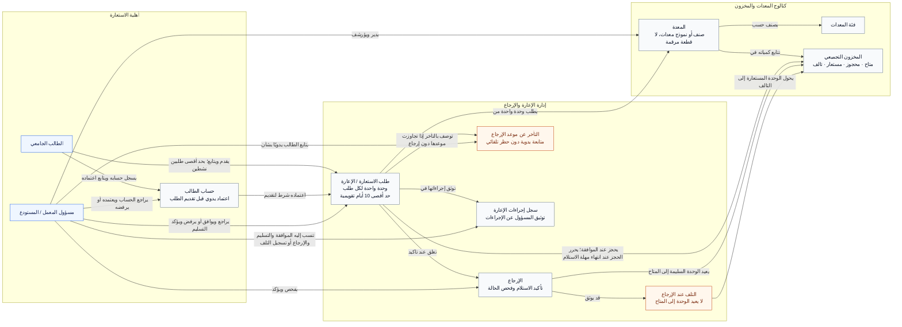

# BorrowHub MVP — النموذج المفاهيمي للمجال

## 1. نظرة عامة على المجال

المجال الأساسي هو **إدارة إعارة المعدات الجامعية**: تمكين الطالب المعتمد من طلب المعدات لأغراض أكاديمية، وتنظيم تخصيص الكميات المحدودة، وتوثيق التسليم والإرجاع والتلف، ومتابعة المعدات المتأخرة يدويًا.

هذا نموذج مفاهيمي للأعمال يوضح ما الذي يديره BorrowHub، ومسؤولية كل مفهوم، والعلاقات التي تحكمه. لا يمثل بنية قاعدة البيانات أو أصناف البرمجيات، والأسهم علاقات أعمال وليست خطوات تنفيذ متتابعة.

### مصادر الحقيقة ونطاق التحليل

- [PRD](../PRD.md): المصدر الأساسي، خصوصًا FR-001–FR-025، الصلاحيات في §15، حالات الحافة في §18، معايير القبول في §23، والقرارات في §26.
- [User Flow](../user-flow.md): مصدر أساسي مكمل، خصوصًا المسارات حسب الدور في §3، وقواعد الأعمال والأسئلة المفتوحة في نهاية الوثيقة.
- `docs/ERD.md` و`docs/database.dbml`: غير موجودين وقت التحليل. لم يستخرج النموذج هيكله من متطلبات البيانات في PRD.

يشمل MVP اعتماد الطلاب، كتالوج المعدات، المخزون بالكميات، مراجعة الطلبات، الحجز عند الموافقة، التسليم، الإرجاع، توثيق التلف والتأخر، وإسناد إجراءات الإعارة إلى المسؤول الذي أجراها. يستبعد تتبع القطع بأرقام تسلسلية، الغرامات، الحظر التلقائي، الإشعارات الخارجية الآلية، والتكامل مع أنظمة الجامعة؛ وفق PRD §4 و§9 و§17.

### حدود المجال ومسؤولياته

| المجال الفرعي | المسؤولية | المفاهيم التابعة |
|---|---|---|
| أهلية الاستعارة | التحقق اليدوي من أهلية الطالب قبل السماح بالطلبات | الطالب، حساب الطالب، مسؤول المعمل / المستودع |
| كتالوج المعدات والمخزون | وصف المعدات وتصنيفها وإدارة كمياتها المتاحة والمحجوزة والمستعارة والتالفة | المعدة، الفئة، المخزون التجميعي |
| إدارة الإعارة والإرجاع | تخصيص المعدات وتوثيق حيازتها وإرجاعها ومتابعة الاستثناءات | طلب الاستعارة / الإعارة، الإرجاع، التلف، التأخر، سجل الإجراءات |

هذه مجموعات تحليلية لتنظيم المسؤوليات، وليست قرارًا بإنشاء خدمات منفصلة أو Bounded Contexts مستقلة. السجلات الجامعية مرجع خارجي للتحقق اليدوي؛ لا يوجد تكامل آلي معها في MVP. مسؤول المعمل يعمل عبر المجالات الثلاثة ولا يستعير المعدات للاستخدام الشخصي (DEC-05).

## 2. المفاهيم الرئيسية ومصطلحات الأعمال

| المفهوم | المعنى والمسؤولية | صاحب القرار أو المسؤولية التشغيلية | الدليل |
|---|---|---|---|
| الطالب الجامعي — Student | طالب يطلب المعدات ويستلمها ويعيدها ويتابع طلباته | الطالب مسؤول عن الغرض الأكاديمي والحضور للاستلام والإرجاع | PRD §5، US-01 وUS-04، User Flow §3.1 |
| حساب الطالب — Student Account | يمثل تسجيل الطالب ونتيجة التحقق من أهليته؛ قيد الاعتماد أو فعال أو مرفوض | الطالب يقدم بياناته؛ المسؤول يراجع ويعتمد أو يرفض | FR-001–FR-005 |
| مسؤول المعمل / المستودع — Admin / Staff | دور أعمال يدير المعدات ويقرر الطلبات ويؤكد الحيازة والإرجاع ويتابع التأخر | المسؤول؛ لا تضاف صلاحيات إعارة شخصية لهذا الدور | PRD §15، DEC-05 |
| المعدة — Equipment | صنف أو نموذج من المعدات الجامعية يمكن طلب وحدة منه؛ ليست قطعة ذات رقم تسلسلي | المسؤول يضيف الوصف ويعدله ويؤرشفه | FR-006–FR-007، NG-01 |
| فئة المعدات — Equipment Category | تصنيف المعدات لتسهيل اكتشافها وتنظيم الكتالوج | المسؤول يدير التصنيفات | FR-007، PRD §14، User Flow §3.1 و§3.2 |
| المخزون التجميعي — Aggregate Inventory | يعبر عن كميات كل صنف وحالتها التشغيلية: المتاح والمحجوز والمستعار والتالف، مع متابعة الإجمالي | المسؤول يدير الكميات؛ قواعد الإعارة تضبط انتقالها | F-02، FR-007–FR-010 |
| طلب الاستعارة / الإعارة — Loan Request / Loan | طلب طالب لمعدة وغرض أكاديمي وفترة محددة؛ يستمر سجل الأعمال نفسه عبر المراجعة والحجز والتسليم والإرجاع | الطالب يقدم ويتابع ويلغي الطلب المعلق؛ المسؤول يراجع ويؤكد التسليم والإرجاع | FR-011–FR-022 |
| الإرجاع — Return | واقعة إعادة المعدات وفحصها وتأكيد استلامها، وتغلق الإعارة وتحدد أثرها على المخزون | الطالب يعيد الوحدة؛ المسؤول يفحص ويؤكد | FR-021–FR-022، AC-04–AC-05 |
| التلف عند الإرجاع — Damage | نتيجة فحص تشير إلى أن الوحدة المعادة لا تعود إلى التداول المتاح، وقد تصاحبها ملاحظات | المسؤول يحدد التلف ويوثقه | FR-010، FR-022، AC-05 |
| التأخر عن موعد الإرجاع — Overdue | وصف لإعارة تجاوزت موعدها المتوقع دون إعادة المعدات؛ يستدعي متابعة يدوية | المسؤول يتواصل مع الطالب ويستخدم تقديره في الطلبات اللاحقة | FR-023–FR-025 |
| سجل إجراءات الإعارة — Loan Action Record | توثيق من وافق على الإعارة ومن أكد التسليم والإرجاع أو التلف | تنسب الإجراءات إلى المسؤول الذي أجراها | NFR-008، User Flow سيناريو الإرجاع التالف |

**الكيانات ذات الاستمرارية في الأعمال:** الطالب وحسابه، صنف المعدة، وطلب الاستعارة المستمر خلال دورة الإعارة. المسؤول دور أعمال؛ المخزون ملخص كمي؛ الإرجاع واقعة؛ التلف نتيجة فحص؛ والتأخر وصف للإعارة. عرض هذه المفاهيم كعقد لا يعني أنها جميعًا كيانات مستقلة.

**مصطلحات مشتركة:** «طلب معلق» ينتظر المراجعة؛ «حجز معتمد» خصصت له وحدة ولم تسلم بعد؛ «إعارة مستلمة» تعني أن الطالب تسلم الوحدة فعليًا؛ «إعارة مغلقة» أكد المسؤول إرجاعها. الحجز مرحلة من الطلب وليس كيانًا إضافيًا. الغرض الأكاديمي، سبب الرفض، مدة الاستعارة، موعد الإرجاع، وملاحظات التلف تفاصيل أعمال داخل المفاهيم المعنية وليست كيانات مستقلة.

## 3. العلاقات بين المفاهيم

| العلاقة المؤكدة | المعنى والقيد | المصدر |
|---|---|---|
| الطالب يسجل حسابه؛ المسؤول يراجع الحساب | اعتماد الحساب شرط لتقديم طلب استعارة | FR-001–FR-005 |
| الطالب يقدم طلب الاستعارة ويتابعه | لا يتجاوز طلبين نشطين وفق تعريف الحالات في PRD؛ الإلغاء الذاتي للمعلق فقط | FR-014–FR-016، DEC-01 وDEC-03 |
| طلب الاستعارة يتعلق بمعدة | صنف واحد ووحدة واحدة لكل طلب في MVP | F-03، FR-014، User Flow قواعد الأعمال 1 |
| المسؤول يراجع الطلب ويؤكد التسليم | الموافقة تخصص وحدة متاحة؛ الرفض يحتاج سببًا؛ التسليم يتطلب طلبًا معتمدًا | FR-017–FR-019 |
| المعدة تصنف حسب فئة وتتابع كمياتها في المخزون | التصنيف ينظم الكتالوج؛ التتبع تجميعي دون هوية لكل قطعة | FR-007، NG-01 |
| الطلب يحجز من المخزون ثم يستخدم الوحدة | الموافقة تحول المتاح إلى محجوز؛ التسليم يحول المحجوز إلى مستعار؛ انتهاء مهلة الاستلام يحرر المحجوز | FR-008، FR-018 |
| الإرجاع يغلق الإعارة ويؤثر على المخزون | السليم يعود للمتاح؛ التالف ينتقل إلى التالف دون زيادة المتاح | FR-009–FR-010، AC-04–AC-05 |
| الإعارة توصف بالتأخر؛ المسؤول يتابع الطالب | تجاوز موعد الإرجاع دون إعادة؛ لا عقوبة أو منع تلقائي | FR-023–FR-025 |
| إجراءات الإعارة توثق وتنسب إلى المسؤول | الموافقة والتسليم والإرجاع أو التلف يجب أن يكون المسؤول عنها معلومًا | NFR-008 |

لا توجد تعدديات عامة مفترضة. العددان الوحيدان المعروضان هما وحدة لكل طلب وطلبان نشطان كحد أقصى لكل طالب، لأنهما مؤكدان صراحة. لا يستنتج النموذج عدد المسؤولين لكل إعارة، أو عدد الفئات لكل معدة، أو عدد الحسابات لكل طالب.

## 4. مخطط المجال المفاهيمي

كل الأسهم المتصلة تمثل علاقات مؤكدة بالمصادر أعلاه. لا توجد علاقات افتراضية في الرسم؛ ما لم يحسم في الوثائق مدرج منفصلًا في الأسئلة المفتوحة. التقسيم والألوان وسائل قراءة فقط: الأزرق للأدوار، والبرتقالي للتلف والتأخر، وبقية العقد للمفاهيم الأخرى.

المصدر المستقل: [domain-model.mmd](domain-model.mmd). يمكن لصقه في [Mermaid Live](https://mermaid.live).

## 5. شرح النموذج بالعربية

يبدأ فهم المجال من **الطالب وأهليته**: التسجيل وحده لا يمنح حق الاستعارة؛ المسؤول يتحقق من الطالب ويعتمد حسابه. لذلك يظهر حساب الطالب منفصلًا عن طلب الاستعارة، حتى لا تختلط الموافقة على أهلية الشخص بالموافقة على طلب معدات معين.

**المعدة** تعني نموذجًا أو صنفًا، مثل كاميرا من نوع معين. **الفئة** تساعد على تنظيم هذه الأصناف، بينما **المخزون التجميعي** يبين الكميات المتاحة والمحجوزة والمستعارة والتالفة. لا يحاول النموذج تعيين رقم تسلسلي للوحدة التي استلمها الطالب، لأن ذلك خارج MVP.

**طلب الاستعارة / الإعارة** هو المفهوم المحوري: يجمع الطالب والمعدة والغرض والفترة المطلوبة. الموافقة لا تعني التسليم؛ هي تخصيص وحدة من المخزون. عند حضور الطالب والتحقق من هويته، يؤكد المسؤول التسليم وتصبح الوحدة مستعارة. لم نفصل الطلب والحجز والإعارة إلى كيانات مرتبطة بتعدديات مخترعة؛ إنها مراحل للمفهوم المستمر نفسه في الوثائق.

**الإرجاع** يغلق الإعارة بعد استلام المسؤول للوحدة وفحصها. إذا كانت سليمة تصبح متاحة مجددًا، وإذا تبين **التلف** تبقى خارج المتاح ويسجل التلف. النموذج يثبت هذا الفرق المؤكد ولا يحسم أثر التلف المختلف عليه على العدد الإجمالي.

**التأخر** يربط موعد الإرجاع بالحيازة غير المنتهية، ويعطي المسؤول أساسًا للمتابعة اليدوية باستخدام بيانات تواصل الطالب. لا ينشئ النموذج غرامة أو حظرًا. **سجل إجراءات الإعارة** يحقق المساءلة بتوثيق المسؤول الذي وافق وسلم واستلم أو سجل التلف.

بهذا يعكس النموذج MVP: اعتماد يدوي، وحدة لكل طلب، مراجعة إدارية، كميات تجميعية، استلام وإرجاع فعليان، ومتابعة استثناءات بسيطة. يعرض مسؤوليات الأعمال دون شاشات أو تقنيات أو تفاصيل تخزين.

## 6. قواعد الأعمال والقيود

| القيد المؤكد | المرجع |
|---|---|
| الحساب الجديد ينتظر الاعتماد؛ الحساب غير المعتمد لا يقدم طلبات | FR-002–FR-004 |
| طلب المعدات يتطلب كمية متاحة؛ يعاد التحقق عند الموافقة لمنع تخصيص آخر وحدة مرتين | FR-011، PRD §13 وEC-01 وAC-02 |
| الطلب يخص وحدة واحدة، وله غرض أكاديمي غير فارغ، ومدة لا تتجاوز 10 أيام تقويمية | FR-012–FR-014، DEC-02 |
| الحد الأقصى طلبان نشطان: قيد المراجعة، معتمد، أو مستلم؛ معاملة التأخر ضمن هذا الحد تحتاج توضيحًا | FR-014، DEC-01 |
| تقديم الطلب المعلق لا يحجز مخزونًا؛ الموافقة تحجز وحدة فورًا حتى لو كان تاريخ البدء مستقبليًا | FR-008، EC-01، AC-02 |
| رفض الطلب يتطلب سببًا؛ الطالب يلغي طلبه المعلق فقط دون تغيير المخزون | FR-016–FR-017، AC-07 |
| عدم الاستلام خلال 48 ساعة من تاريخ البدء المطلوب ينهي الحجز ويعيد الوحدة للمتاح | FR-018، AC-08، User Flow قواعد الأعمال 7 |
| التسليم الفعلي لطلب معتمد فقط، بعد تحقق المسؤول من هوية الطالب، وينقل الوحدة من المحجوز إلى المستعار | FR-019، PRD §13.2 |
| الإرجاع السليم يعيد الوحدة إلى المتاح؛ الإرجاع التالف يحولها إلى التالف دون زيادة المتاح ويغلق الإعارة | FR-009–FR-010، AC-04–AC-05 |
| تجاوز موعد الإرجاع دون إعادة يستدعي وصف التأخر والمتابعة اليدوية؛ لا يمنع الطلبات التالية تلقائيًا مع استمرار القيود الأخرى | FR-023–FR-025 |
| توثق مسؤولية الموافقة والتسليم والإرجاع أو تسجيل التلف؛ بيانات الاتصال الشخصية متاحة للمسؤولين المخولين فقط | NFR-008، SEC-03 |
| المسؤول يدير المعاملات ولا يستعير المعدات شخصيًا في MVP | DEC-05 |

## 7. التحقق من النموذج

- **التغطية:** شمل أهلية الطالب والمعدة وتصنيفها والمخزون وتخصيص الوحدة والإرجاع والتلف والتأخر والمساءلة. الغرض والتواريخ والأسباب تفاصيل أعمال موضحة في النص بدل تضخيم الرسم.
- **صحة العلاقات:** ربط تخصيص المخزون بالموافقة، لا بمجرد تقديم الطلب ولا بالتسليم وحده. فصل سلامة الإرجاع عن التأخر؛ كلاهما يتعلق بإعارة قائمة ولا ينشئ صنف معدات جديدًا.
- **تقليل المفاهيم:** لم تضف الجامعة أو القسم أو المعمل ككيانات تنظيمية مستقلة، لعدم وجود قواعد إدارة أو تعدديات كافية لها. الإحصاءات ملخصات للمفاهيم القائمة، وليست كيانات إضافية.
- **المصطلحات والمسؤوليات:** استخدمت أسماء PRD مع ترجمتها، وميزت اعتماد الحساب عن اعتماد الطلب، وبيّنت دور الطالب ودور المسؤول لكل مفهوم.
- **تعارضات المصادر:** لم تحول الصياغات المتعارضة إلى قواعد جديدة؛ سجلت أدناه القضايا التي تؤثر على تفسير المجال. لا يحتوي الرسم علاقات غير مؤكدة.

## 8. قرارات التمثيل والأسئلة المفتوحة

### قرارات تحليلية وليست متطلبات جديدة

توحيد الطلب والإعارة في عقدة واحدة، وعرض الإرجاع كواقعة والتلف كنتيجة والتأخر كوصف، واستخدام ثلاث مجموعات مسؤولية هي قرارات لقراءة النموذج. لا تفترض كيانات تخزين منفصلة أو دورة صيانة أو تنظيمًا متعدد المستودعات. لا توجد علاقات أعمال مفترضة مضافة.

### أسئلة غير محسومة

| السؤال | موضع الغموض أو التعارض | ما يثبته النموذج دون افتراض |
|---|---|---|
| هل يحسب موعد الإرجاع من تاريخ البدء المطلوب أم من التسليم الفعلي؟ وهل تعتمد المدة المختارة أم عشرة أيام دائمًا؟ | FR-012 وUser Flow قواعد الأعمال 3 يبدآن من التاريخ المطلوب؛ AC-03 وPRD §13.1 يذكران بدء العداد عند التسليم | حد أقصى 10 أيام تقويمية وموعد إرجاع متوقع؛ لا تثبت نقطة بدء متعارضة |
| هل التأخر حالة مستقلة أم وصف للإعارة المستلمة؟ وكيف يدخل في الحد النشط وتأكيد الإرجاع؟ | FR-023 يربط التأخر بإعارة مستلمة؛ FR-014 وEC-04 لا يذكران حالة التأخر ضمن الحالات المسموحة، بينما User Flow §3.2 يسمح بإرجاع المتأخر | التأخر وصف أعمال لحيازة لم تنته، دون حسم تمثيله أو استثناءه من الحد |
| هل ينقص التلف إجمالي المخزون أيضًا؟ وما تعريف الإجمالي بالنسبة للتالف؟ | US-08 وEC-02 يذكران خفض الإجمالي؛ FR-010 وAC-05 وUser Flow يذكرون تحويل المستعار إلى التالف دون تحديد أثر الإجمالي | عدم زيادة المتاح وتحويل الوحدة إلى التالف؛ لا تفترض معادلة إجمالي |
| هل ملاحظات التلف اختيارية أم إلزامية؟ | FR-022 ينص على الاختيارية؛ User Flow §3.2 عند تسجيل التلف ينص على الإلزامية | التلف يوثق، وتبقى إلزامية الملاحظات غير محسومة |
| هل للمسؤول إلغاء حجز معتمد يدويًا قبل انتهاء المهلة؟ | FR-008 يذكر تحرير مخزون الحجز الملغى؛ صلاحية الإلغاء الصريحة للطالب تخص المعلق فقط؛ User Flow الأسئلة المفتوحة 1 | تحرير الحجز المنتهي تلقائيًا وإلغاء الطالب للمعلق فقط |
| ما حدود تعديل الكميات أو أرشفة صنف عليه حجوزات أو إعارات غير مغلقة؟ | FR-006–FR-007 يجيزان الإدارة دون بيان هذه القيود | مسؤولية إدارة الكتالوج دون اختراع سياسة للأرشفة أو تسوية الكميات |
| هل التمديد أو تعديل موعد الإرجاع ضمن MVP؟ | غير مقرر في المتطلبات؛ ورد كسؤال في نهاية User Flow | لا علاقة تمديد ولا صلاحية تغيير موعد مضافة |
| هل التعليق اليدوي لحساب الطالب ضمن MVP، وما شروطه؟ | PRD §14 يذكر إجراء Suspend، بينما حالات الحساب وصلاحياته لا تعرف دورة التعليق | اعتماد أو رفض الحساب فقط؛ لا تضيف دورة تعليق |
| ماذا يحدث للطلب عند نفاد المخزون وقت المراجعة: يبقى معلقًا أم يرفض؟ | مخطط User Flow يوجه إلى الرفض، وشرح الأخطاء يسمح بالرفض أو الانتظار؛ PRD يثبت فشل الموافقة فقط | تمنع الموافقة دون مخزون، ولا تفرض نتيجة أخرى |

**توضيح لسؤال ورد في User Flow:** توقيت حجز طلب مستقبلي محسوم في FR-008 وAC-02: التخصيص فوري عند الموافقة، وليس عند حلول تاريخ البدء. تبدأ مهلة عدم الحضور من تاريخ البدء المطلوب وفق FR-018؛ لا يضيف النموذج تقويم حجوزات زمنية.
