# مخططات التتابع — BorrowHub MVP

## الغرض والمصادر

يوثق هذا الملف تحليل المتطلبات ثم **15 مخطط تتابع مستقل** لحالات الاستخدام الرئيسية. الشرح بالعربية، وأسماء المشاركين والرسائل بالإنجليزية لسهولة مراجعة Mermaid. المخططات نماذج منطقية وليست وصفاً لكود أو واجهات API منفذة.

المصدر الوحيد لقواعد المنتج هو [PRD v1.0.0](../PRD.md)، و[تدفق المستخدم](../user-flow.md)، و[تحليل حالات الاستخدام](use-case.md). روجعت أيضاً [مسارات المهام](../flows/README.md) للتحقق من الاتساق. **لم يُعثر على `docs/ERD.md` أو `docs/database.dbml`**؛ أسماء User وEquipment وLoanRequest تشير إلى كيانات PRD §16، ولا تفترض أسماء جداول أو محرك قاعدة بيانات. تخزين الجلسات وسجل التدقيق والفئات غير محدد في مخطط بيانات فعلي.

عند اختلاف المصادر، يعرض الرسم الجزء المتفق عليه ويسمي نقطة الخلاف. لا تُحوّل هذه الوثيقة الأسئلة المفتوحة إلى قرارات أعمال. تُستخدم [وثائق Mermaid الرسمية](https://mermaid.js.org/syntax/sequenceDiagram.html) للصياغة فقط.

## تحليل المتطلبات وتغطيتها

| المخطط / حالة الاستخدام | الممثل | الطلب والاستجابة الناجحة | التحقق وقواعد الأعمال | القراءة والكتابة / البدائل والفشل | المصدر |
| --- | --- | --- | --- | --- | --- |
| [SD01 — التسجيل](#sd01) / UC01 | الطالب | إرسال البيانات؛ حساب PENDING_APPROVAL | الحقول الستة، بريد جامعي، تفرد البريد والرقم الجامعي، حماية التسجيل وكلمة المرور | قراءة التفرد؛ حفظ User مع hash؛ مدخلات ناقصة أو تكرار أو فشل حفظ | FR-001–002، EC-03، SEC-01، SEC-04 |
| [SD02 — الدخول](#sd02) / UC02 | الطالب أو المسؤول | إرسال البريد وكلمة المرور؛ جلسة وبوابة الدور | تحديد المعدل، فحص hash، الحالة ACTIVE، انتهاء الجلسة | قراءة User؛ بيانات خاطئة أو حساب غير نشط؛ وصول المعلق Q01 | FR-005، NFR-005–006، SEC-01–04 |
| [SD03 — مراجعة الحساب](#sd03) / UC04 | المسؤول | عرض المعلقين ثم تفعيل أو رفض | ADMIN؛ مطابقة يدوية؛ إعادة فحص PENDING_APPROVAL | قراءة User؛ تحديث ACTIVE أو REJECTED؛ تعارض مراجعة أو فشل حفظ | FR-004، US-02، PRD §13.2 |
| [SD04 — الكتالوج والبحث](#sd04) / UC06–07، UC23 | الطالب أو المسؤول | عرض المعدات والتوفر؛ بحث اختياري | صلاحيات العرض؛ لا حجز؛ الطلب يتطلب ACTIVE | قراءة Equipment؛ نتائج فارغة أو فشل قراءة؛ المعلق/رصيد صفر Q01 | FR-011، PRD §14–15 |
| [SD05 — إدارة المعدات](#sd05) / UC08 | المسؤول | إضافة أو تعديل أو أرشفة | ADMIN؛ الكميات أعداد صحيحة غير سالبة؛ قيود تعديل الأرصدة Q08 | قراءة Equipment وأرصدة مرتبطة؛ حفظ التغيير؛ خطأ إدخال أو تعارض أو فشل | FR-006–007، PRD §14، NFR-002 |
| [SD06 — إدارة الفئات](#sd06) / UC09 | المسؤول | عرض وإضافة وتعديل وحذف فئة | ADMIN؛ بيانات الفئة؛ شروط حذف المرتبط Q08 | قراءة/كتابة بيانات الفئات؛ سياسة الحذف غير محسومة | PRD §14، Admin Portal 7 |
| [SD07 — تقديم طلب](#sd07) / UC10، UC23 | الطالب | تقديم طلب؛ PENDING_REVIEW | ACTIVE، كمية 1، أقل من 2 نشطين، مدة ≤10 أيام تقويمية، غرض غير فارغ، توفر | قراءة User وEquipment وLoanRequest؛ حفظ الطلب بلا حجز؛ ERR-AUTH/INV/DUR/LMT | FR-003، FR-011–015، AC-01، DEC-01–02 |
| [SD08 — متابعة الطلبات](#sd08) / UC11 | الطالب | عرض طلباته وحالاتها ومواعيدها | ملكية البيانات؛ لا بيانات طلاب آخرين | قراءة LoanRequest وEquipment؛ قائمة فارغة؛ سبب الرفض ومهلة الاستلام والتأخير | PRD §13.1، §14–15، SEC-03 |
| [SD09 — الإلغاء الذاتي](#sd09) / UC12 | الطالب | إلغاء طلبه؛ CANCELLED | ACTIVE؛ ملكية الطلب؛ PENDING_REVIEW فقط | تحديث شرطي؛ لا تغيير مخزون؛ تعارض مع الموافقة أو ملكية خاطئة | FR-016، AC-07، DEC-03 |
| [SD10 — مراجعة الطلب واتخاذ القرار](#sd10) / UC13–15، UC23–24 | المسؤول | اعتماد وحجز أو رفض مع سبب | ADMIN؛ PENDING_REVIEW؛ سبب إلزامي للرفض؛ توفر لحظة الاعتماد | قراءة الطلب والطالب والمعدة؛ كتابة القرار؛ حجز ذري؛ ERR-ACT-01 أو تعارض أو rollback | FR-008، FR-017، AC-02، EC-01، NFR-008 |
| [SD11 — التسليم](#sd11) / UC16، UC24 | المسؤول؛ الطالب فعلياً | تأكيد التسليم؛ CHECKED_OUT | تحقق هوية يدوي؛ APPROVED؛ صلاحية مهلة الاستلام | reserved −1، borrowed +1؛ حفظ الوقت والمدقق؛ تعارض مع الانتهاء؛ موعد الإرجاع Q02 | FR-008، FR-019–020، AC-03، NFR-008 |
| [SD12 — الإرجاع والفحص والتلف](#sd12) / UC17–18، UC24 | المسؤول؛ الطالب فعلياً | إغلاق الإعارة وتسجيل الحالة | فحص فعلي؛ إعارة مسلمة وغير مغلقة؛ قواعد المتأخر والتلف Q03–05 | borrowed −1؛ available +1 أو damaged +1؛ وقت الإرجاع والتدقيق؛ تكرار أو فشل ذري | FR-009–010، FR-020–022، AC-04–05 |
| [SD13 — انتهاء الحجز](#sd13) / UC21، UC24 | لا ممثل بشري بادئ | تقييم داخلي؛ EXPIRED وتحرير الوحدة | APPROVED وعدم الاستلام بعد مهلة 48 ساعة من start_date | قراءة مرشحين؛ تحديث شرطي ذري؛ تجاهل سجل تغير بالتزامن؛ rollback | FR-018، AC-08، EC-06، DEC-04 |
| [SD14 — كشف التأخير والمتابعة](#sd14) / UC20، UC22 | تقييم داخلي ثم المسؤول | كشف التأخير؛ عرض بيانات التواصل للمتابعة اليدوية | الوقت تجاوز موعد الاستحقاق ولم تُعد المعدة؛ ADMIN لبيانات التواصل | قراءة الإعارات والطالب والمعدات؛ وسم/حالة Q03؛ لا تعديل مخزون؛ قائمة فارغة أو فشل قراءة | FR-023–025، AC-06، SEC-03 |
| [SD15 — لوحة الإدارة](#sd15) / UC19 | المسؤول | عرض مؤشرات المخزون والطلبات والإعارات والتأخير | ADMIN؛ تعريف النشط والمتأخر Q03 | قراءات تجميعية؛ صفر سجلات أو فشل قراءة؛ لا كتابة | PRD §14، Admin Portal 5 |

## المشاركون ومسؤولياتهم

| المشارك | المسؤولية وحدود النموذج |
| --- | --- |
| Student / Admin / User (`actor`) | البشر الذين يبدأون إجراءات الواجهة. User في SD02 وSD04 يعني الطالب أو المسؤول، وليس دوراً جديداً. |
| Web UI (`participant`) | إدخال البيانات، تحقق أولي، إرسال الطلب وعرض النتيجة. صلاحيات الواجهة لا تغني عن تحقق الخادم. |
| BorrowHub Application (`participant`) | الجلسة، RBAC، التحقق من المدخلات والملكية والحالة، تطبيق القواعد، حساب البيانات المعروضة وتنسيق المعاملات. تقسيم منطقي واحد؛ لا افتراض لخدمات مصغرة. |
| Database (`participant`) | حفظ وقراءة الكيانات، التفرد والتحديثات المشروطة والمعاملات الذرية وسجل التدقيق المطلوب. لا افتراض لـSQL أو ORM بعينه. |
| BorrowHub Internal Evaluation (`participant`) | بدء تقييم الانتهاء/التأخير داخل التطبيق. آلية التشغيل وتواتره غير محسومين في المصادر الأساسية؛ ليس ممثلاً خارجياً أو منتج جدولة مؤكداً. |

## قواعد القراءة والتحقق المشتركة

- `->>` طلب، و`-->>` استجابة، والأسهم الذاتية تحقق/معالجة داخلية. الرسائل البشرية بين الطالب والمسؤول في SD11–12 تمثل الحضور الفعلي خارج الويب.
- كل عملية محمية تبدأ بفحص الجلسة والدور على الخادم؛ عمليات الطالب تقيد القراءة/الكتابة بمالك الطلب. لا تُرسل بيانات تواصل الطلاب إلى واجهات الطلاب الآخرين.
- جميع المدخلات تتحقق على الخادم وتُعالج بأمان وفق NFR-007؛ تحقق الواجهة لتحسين تجربة الاستخدام. فحص المعدلات مطلوب للدخول والتسجيل وفق SEC-04.
- `BEGIN / COMMIT / ROLLBACK` حدود منطقية للمعاملة. فحص الحالة والمخزون والتعديل وسجل تدقيق الاعتماد/التسليم/الإرجاع عملية واحدة: لا نجاح قبل COMMIT، ولا تحديث جزئي عند الفشل.
- إعادة فحص الحالة داخل المعاملة/التحديث الشرطي تمنع الإلغاء والموافقة المتزامنين، أو التسليم والانتهاء المتزامنين، أو مضاعفة أثر النقر المكرر. هذه معالجة لسلامة العمليات وليست قاعدة أعمال جديدة.
- في SD07 يجب حماية عدّ الطلبات النشطة وحفظ الطلب من التقديم المتزامن للطالب نفسه؛ لا تكفي قراءة العدد ثم كتابة مستقلة. هذه مسؤولية منطقية، دون فرض وسيلة قفل محددة.
- أخطاء الجلسة والصلاحيات والتعارض والمدخلات تستخدم رسائل وصفية؛ لا تُخترع لها رموز ERR. الرموز الموجودة مأخوذة من PRD §19.
- `ERR-NET-01` يغطي انقطاع الشبكة/فشل الخادم. إذا ضاعت الاستجابة بعد COMMIT فقد تكون العملية نجحت؛ تُحدَّث حالة السجل قبل إعادة المحاولة، ولا يُفترض أن انقطاع الاتصال يعني rollback.
- الحالة والمخزون والتفرد تُفحص في قاعدة البيانات عند الكتابة، حتى لو عرضت الواجهة بيانات قديمة. قوائم العرض لا تحجز معدات.
- لا `par` لأن التوازي غير مطلوب في المسارات المؤكدة. `loop` مخصص فقط لمعالجة مجموعة مرشحين. إشعارات الـMVP هي بيانات وحالات داخل لوحات المنصة، وليست رسائل بريد/SMS أو push.

## التعارضات وحدود التفصيل

تطابق المعرفات Q01–Q14 [سجل الأسئلة الموجود](use-case.md#المتطلبات-الناقصة-والأسئلة-المفتوحة). النقاط المؤثرة مباشرة:

| النقطة | أثرها على نمذجة التتابع |
| --- | --- |
| Q01 — دخول الحساب المعلق وظهور المخزون الصفري | SD02 يوضح دخول ACTIVE المؤكد؛ لا يخترع جلسة للمعلق. SD04 وSD08 يتركان وصول المعلق مفتوحاً وفق §15. عرض المعدات ذات الرصيد صفر أيضاً غير محسوم. |
| Q02 / Q10 — المواعيد | SD07 يطبق سقف 10 أيام من start_date. SD11 يوضح وجوب وجود موعد إرجاع، دون اختيار إعادة حسابه من التسليم. منطقة الوقت وحدود اليوم والاستلام المبكر والاعتماد المتأخر غير محددة؛ لا يُفترض أن كل إعارة مدتها 10 أيام. |
| Q03 — OVERDUE | SD12 وSD14–15 يعرضان التأخير كسلوك مؤكد، ويضعان الحالة الدائمة/الوسم وحصة الطلبين وقبول إرجاع الحالة OVERDUE كقرارات مفتوحة. لا يُحسم هذا الخيار بتغيير enum ضمن هذه المهمة. |
| Q04–05 — التلف | الحسابات المتفق عليها هي borrowed −1 وdamaged +1 دون استعادة available. أثر total_quantity مختلف بين EC-02 وAC-05؛ لا تُفرض معادلة إجمالي. SD12 يعرض RETURNED وفق AC-05 مع ملاحظة اختلاف DAMAGED. ملاحظات التلف اختيارية في FR-022 وإلزامية في التدفق؛ تُترك الإلزامية مفتوحة. |
| Q08 — المخزون والفئات | SD05–06 نماذج جزئية للعمليات المؤكدة. قيود الأرشفة وخفض الأرصدة وحذف فئة مرتبطة غير معروفة؛ لا يقرر الرسم حذفاً متسلسلاً أو تحرير حجوزات. يلزم حسمها قبل تنفيذ هذه الفروع. |
| Q11 — نفاد المخزون عند الاعتماد | SD10 يفشل محاولة الاعتماد بلا تغيير حالة أو مخزون. الانتقال إلى REJECTED يتطلب قرار رفض مستقل وسبباً؛ سياسة فرض الرفض أو الانتظار غير محسومة. |
| تعارضات مسارات المهام التفصيلية | مسار التأخير يذكر بريداً آلياً وcron منتصف الليل، ومسار التلف يذكر تكلفة تلف إلزامية وإحالة صيانة. PRD §9 و§17 يستبعد الرسائل الآلية، ولا يؤكد تكلفة أو سير صيانة؛ لا تُضاف هذه التفاعلات. |

**حالات معروفة لا تتوافر لها خطوات كافية:** UC03 استعادة كلمة المرور وUC05 التعليق اليدوي مذكورتان، لكن وسيلة التحقق، انتقالات الحالة وآثارها غير معرفة (Q06–07). لا يمكن تقديم تتابع تنفيذي لهما دون اختراع قواعد. كذلك لا نمذجة لإنشاء ADMIN أو إلغاء APPROVED يدوياً أو التمديد أو الفقد أو تقارير/تصدير جديد (Q09، Q12–14). UC23–24 سلوكان مشتركان مدمجان في المخططات الأصلية وليسا أهدافاً مستقلة للمستخدم.

## SD01 — إنشاء حساب الطالب

**قبل التنفيذ:** الطالب يقدم نموذج التسجيل. **بعد النجاح:** User بحالة PENDING_APPROVAL؛ لا حق لتقديم إعارة حتى التفعيل. **المراجع:** FR-001–002، EC-03، SEC-01، SEC-04.

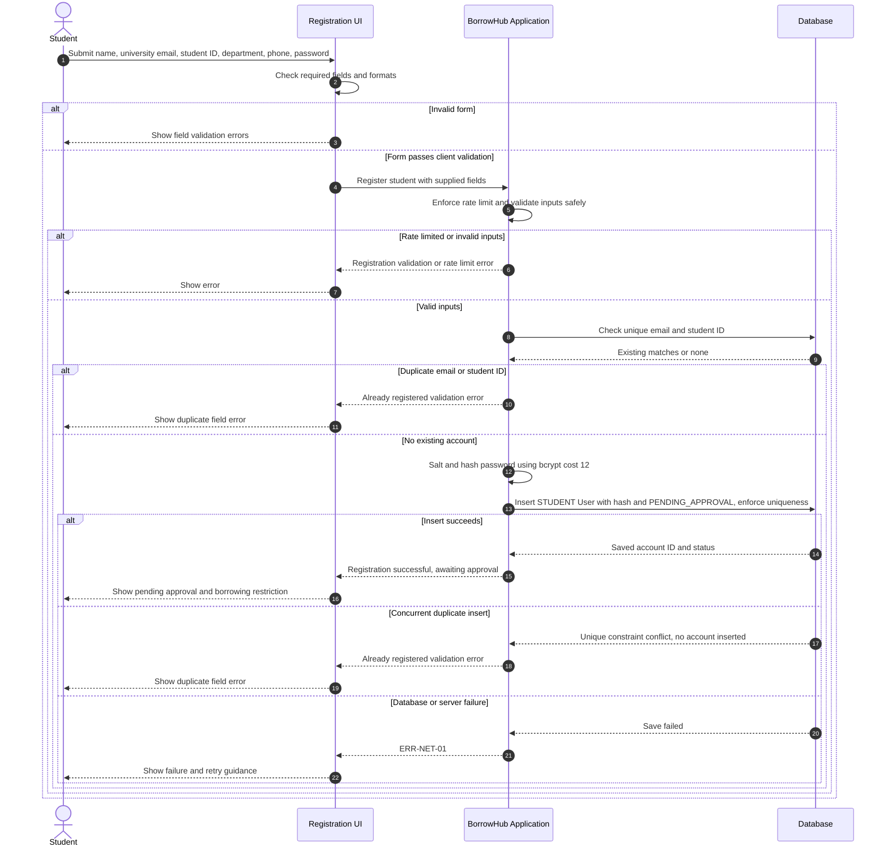

صيغة البريد الجامعي وسياسة كلمة المرور وأرقام الهاتف غير محددة تفصيلياً؛ لا يفترض الرسم نطاق جامعة أو تعبير تحقق معيناً. كلمة المرور ليست نصاً محفوظاً، رغم عدم إدراج حقل hash في ملخص User في PRD §16.

## SD02 — تسجيل الدخول

**بعد النجاح:** جلسة لحساب ACTIVE وتوجيه حسب الدور. **المراجع:** FR-005، SEC-01–04، NFR-006. الحساب المعلق/المرفوض لا يحصل هنا على جلسة دخول كاملة؛ وصول الصفحات المسموح بها للمعلق يبقى Q01.

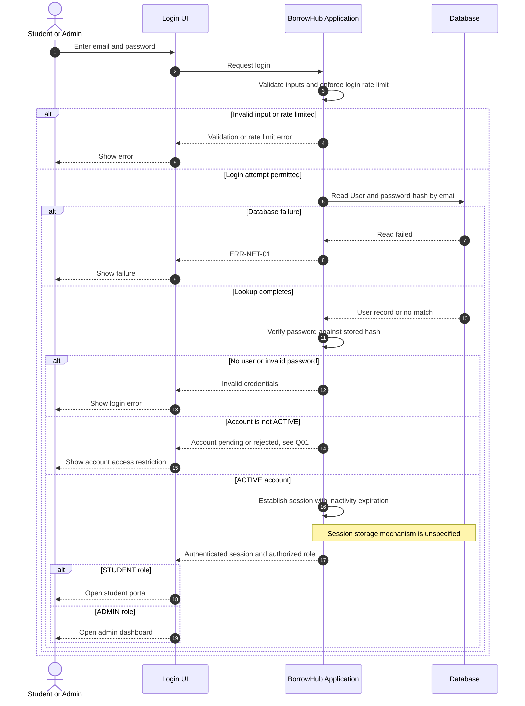

## SD03 — مراجعة حساب الطالب واعتماده أو رفضه

**قبل التنفيذ:** مسؤول مصادق عليه. **بعد النجاح:** ACTIVE أو REJECTED بقرار يدوي. لا يُفرض سبب رفض التسجيل؛ السبب الإلزامي موثق لرفض الإعارة فقط.

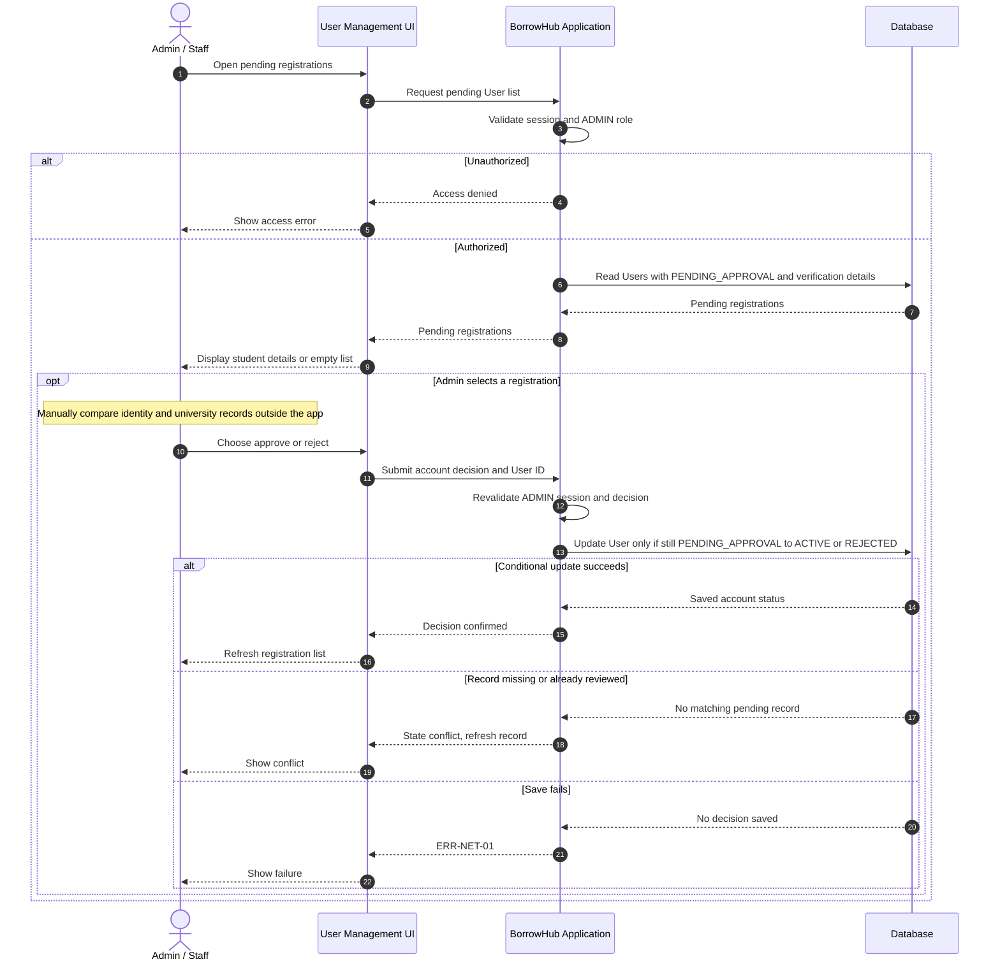

فشل قراءة القائمة يعرض ERR-NET-01 بدلاً من قائمة فارغة. إعادة التحقق عند إرسال القرار شرط لبدء الكتابة؛ عند فشل الصلاحية لا تُنفذ رسالة التحديث.

## SD04 — تصفح الكتالوج والبحث والتصفية

**المراجع:** UC06–07، FR-011، PRD §14–15. يعرض الرسم صلاحية العرض بعد تحققها؛ طريقة وصول الحساب المعلق وعرض عناصر الرصيد صفر تحتاجان Q01. الاستعراض لا يخصص مخزوناً.

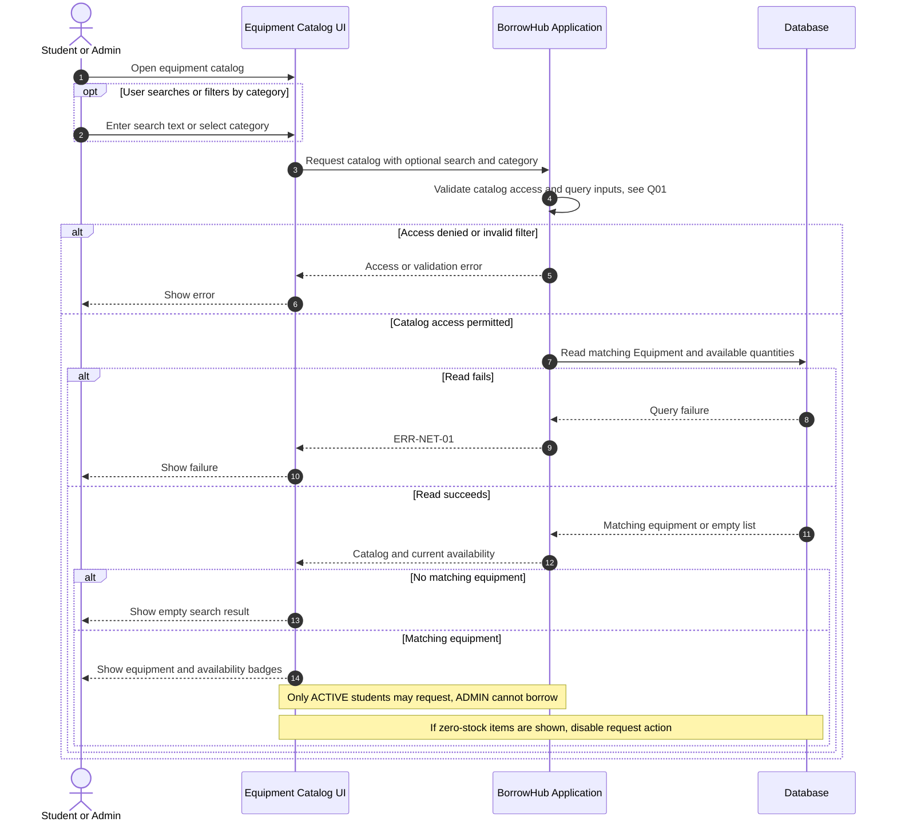

## SD05 — إضافة المعدات وتعديلها وأرشفتها

**المراجع:** FR-006–007، PRD §14، Q08. المخطط يوضح التفاعل المؤكد؛ قواعد تعديل الكميات والأرشفة مع حجوزات/إعارات قائمة غير مكتملة، ولا يسمح النموذج بتجاوزها بافتراض جديد.

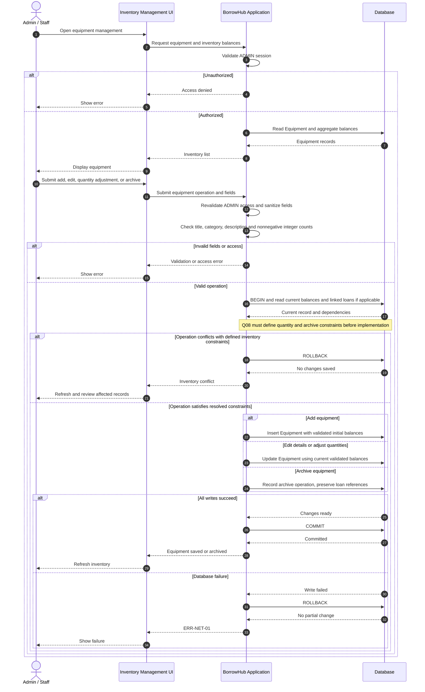

أسماء حقول الأرشفة، تهيئة الأرصدة ومعادلة total_quantity غير محددة. لا يحوّل الرسم الأرشفة إلى حذف المعدات ولا يحرر الحجز تلقائياً بسبب تعديل الكتالوج. فشل القراءة الأولى يظهر ERR-NET-01.

## SD06 — إدارة فئات المعدات

**المراجع:** PRD §14، UC09، Q08. CRUD للفئات مؤكد؛ الحقول والتفرد وشروط حذف المرتبط غير محددة. فرع الحذف مشروط بحسم السياسة، ولا يعني أن الحذف مسموح لكل فئة.

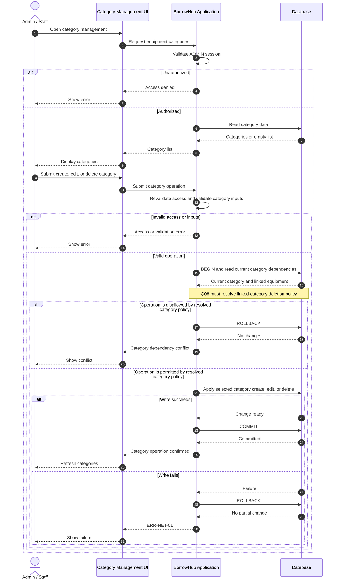

فشل قراءة الفئات يعرض ERR-NET-01. لا يُفترض حذف المعدات التابعة أو نقلها تلقائياً إلى فئة أخرى.

## SD07 — تقديم طلب استعارة

**قبل التنفيذ:** طالب مصادق عليه اختار معدة. **بعد النجاح:** PENDING_REVIEW وrequested_at؛ لا تعديل مخزون. **المراجع:** FR-003، FR-011–015، FR-020، AC-01، EC-01 وEC-05 وEC-07.

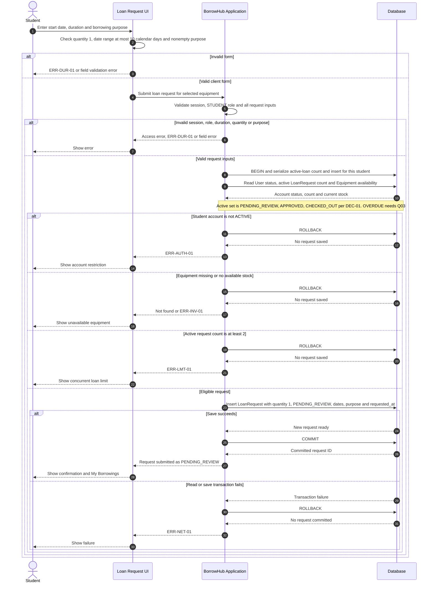

وجود رصيد عند تقديم الطلب لا يضمن الموافقة لاحقاً. طلبان لآخر وحدة قد يبقيان PENDING_REVIEW وفق EC-01؛ الحجز يحدث فقط في SD10. فشل القراءة داخل المعاملة يوقفها وينفذ rollback؛ لا يصل التنفيذ إلى فروع الأهلية ببيانات مفقودة. الحد الأدنى للمدة والتاريخ الماضي غير محددين (Q10).

## SD08 — متابعة الطلبات والإعارات الشخصية

**المراجع:** UC11، PRD §13.1 و§14–15. النتيجة مقتصرة على بيانات الطالب نفسه، دون إشعارات خارجية أو polling مفترض.

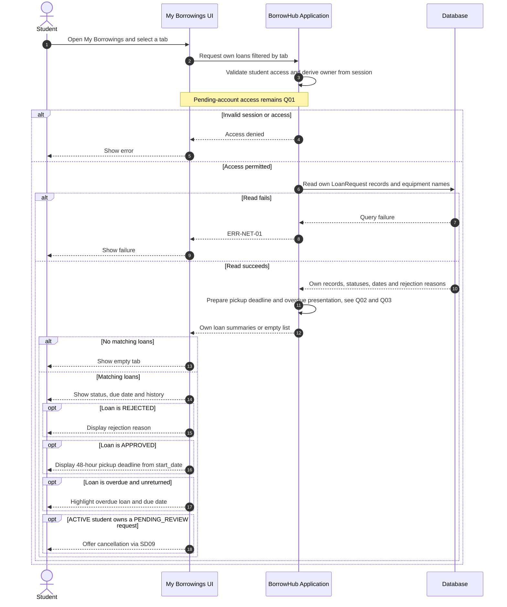

## SD09 — إلغاء الطالب لطلبه المعلق

**المراجع:** FR-016، AC-07، DEC-03. لا إلغاء ذاتي لـAPPROVED، ولا تغيير للمخزون.

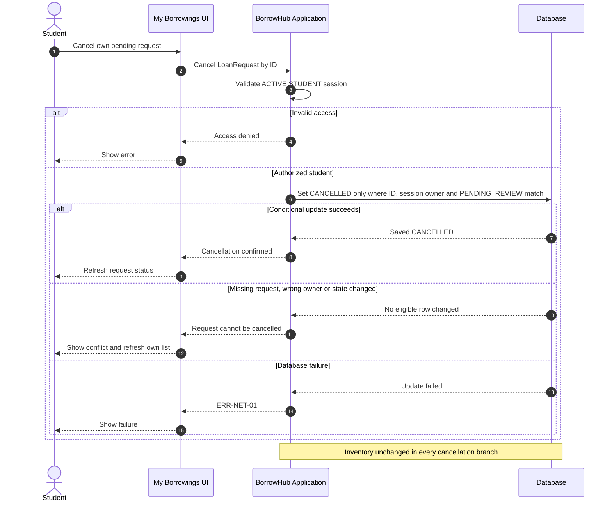

## SD10 — مراجعة طلبات القسم واعتماد الطلب أو رفضه

**قبل التنفيذ:** ADMIN؛ الطلب المتوقع PENDING_REVIEW. **بعد النجاح:** APPROVED مع حجز وحدة أو REJECTED مع سبب. **المراجع:** FR-008، FR-017، AC-02، EC-01، NFR-002 وNFR-008، Q11.

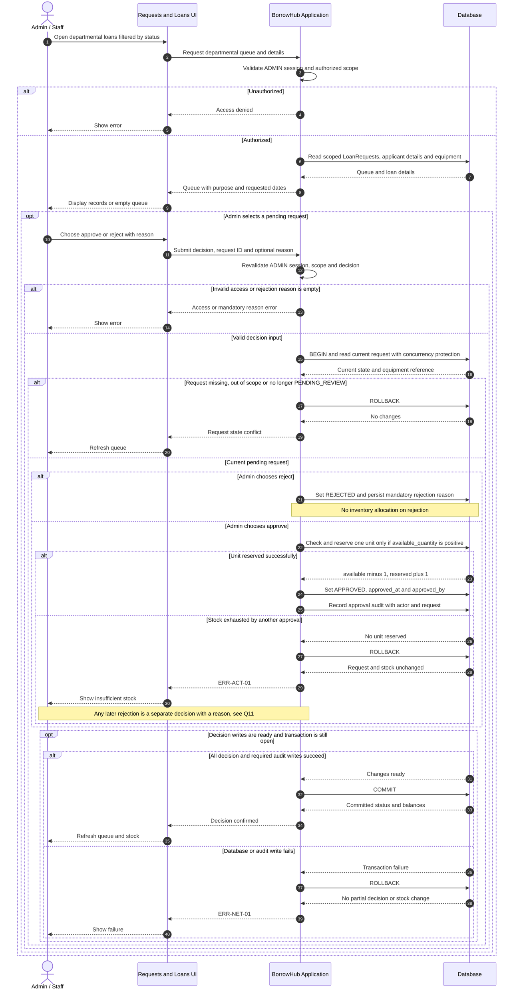

يتم الحجز فور الموافقة حتى لو كان start_date مستقبلياً؛ مهلة الاستلام تحسب من start_date لا approved_at. تُعرض النتيجة للطالب عند قراءة SD08، دون إرسال آلي. فشل قراءة القائمة أو الطلب يوقف العملية ويعرض ERR-NET-01؛ فشل أي قراءة داخل معاملة مفتوحة يستلزم rollback.

## SD11 — تأكيد التسليم الفعلي

**المراجع:** FR-008، FR-019–020، AC-03، NFR-008. التسليم والانتهاء يتنافسان على الطلب نفسه، لذلك تُعاد قراءة حالته داخل المعاملة.

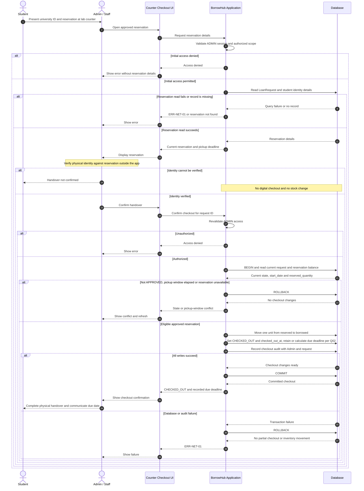

فشل صلاحية أو قراءة تفاصيل الحجز يمنع عرضها ويوقف المسار؛ لا تتم كتابة على أساس بيانات غير مقروءة. الموعد يبدأ من start_date في FR-012، بينما AC-03 يبدأ العداد عند التسليم؛ **Q02 يحتاج حسم قبل التنفيذ**. لا يفترض الرسم التسليم المبكر أو اختيار مدة 10 أيام لكل طلب (Q10).

## SD12 — تأكيد الإرجاع السليم أو المتضرر

**المراجع:** FR-009–010، FR-020–022، AC-04–05، NFR-008؛ الأسئلة Q03–05. يُظهر المخطط RETURNED للإغلاق وفق معايير القبول، مع بيان خلاف DAMAGED في النص، ولا يغير enum فعلياً.

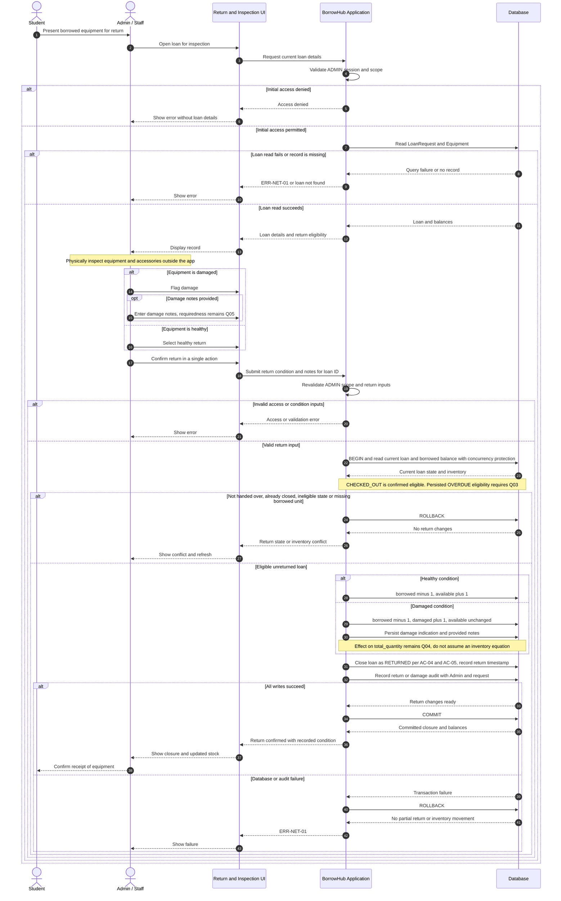

فشل الصلاحية أو القراءة الأولى يوقف المسار. ختم returned_at في FR-020 يقابله actual_return_date في ملخص البيانات؛ هذه تسمية مفهومية واحدة هنا، ولا تُفترض أعمدة إضافية. لا تُحصّل تكلفة تلف، ولا يبدأ سير صيانة آلي. إغلاق الإعارة يخرجها من الحصة النشطة دون عداد حصة مخزن إضافي.

## SD13 — انتهاء الحجز غير المستلم وتحرير المخزون

**المراجع:** FR-018، AC-08، DEC-04. لا ممثل بشري يبدأ هذا السلوك الداخلي؛ الطالب يرى نتيجته لاحقاً في SD08. الحد الدقيق والمنطقة الزمنية لمهلة 48 ساعة يحتاجان حسم Q02/Q10.

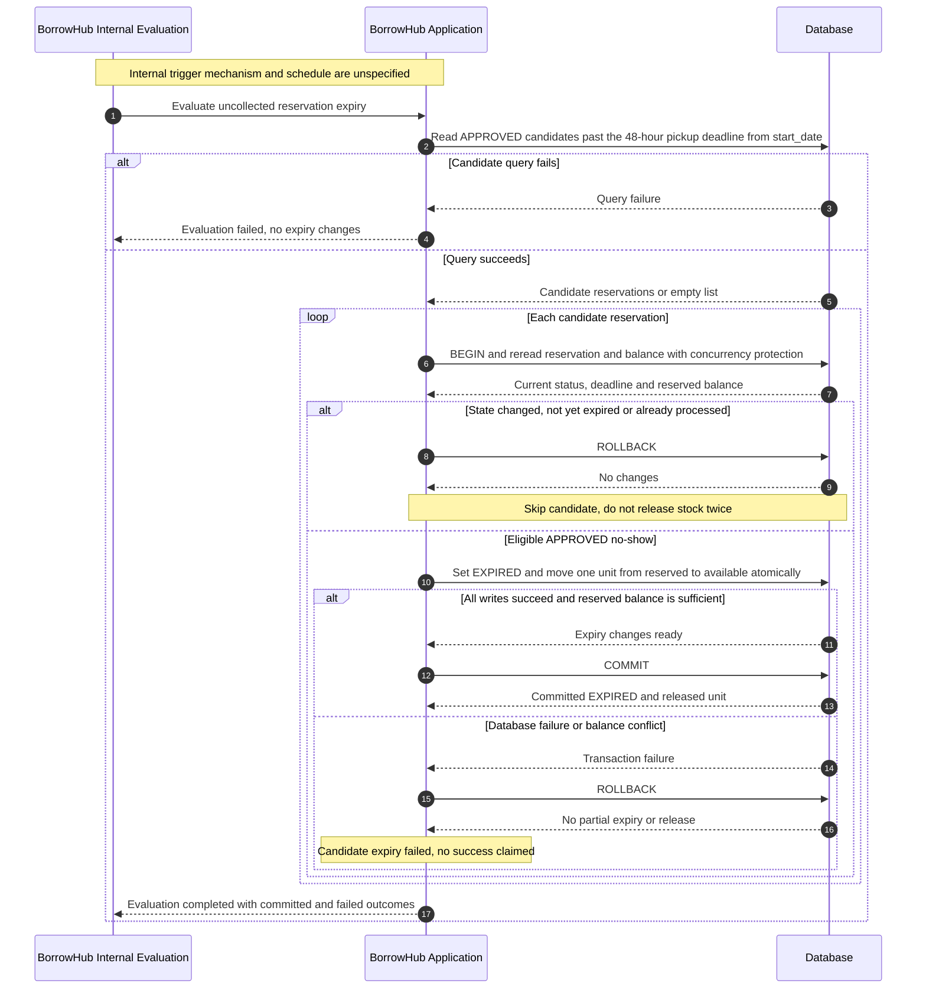

إعادة قراءة فاشلة تعامل كفشل المعاملة مع rollback، لا كسجل مستوفٍ للانتهاء. التسليم الذي يسبق هذا التحديث يجعل الطلب غير APPROVED؛ الانتهاء الذي يسبق التسليم يجعل SD11 يرفضه. لا تُحدد هذه الوثيقة سياسة إعادة محاولة أو منصة cron.

## SD14 — كشف التأخير واستعراض المتأخرين وبيانات التواصل

**المراجع:** FR-023–025، AC-06، SEC-03، Q02–03. التقييم والمطالعة حدثان مستقلان في المخطط؛ ليس هناك push تلقائي إلى واجهة المسؤول.

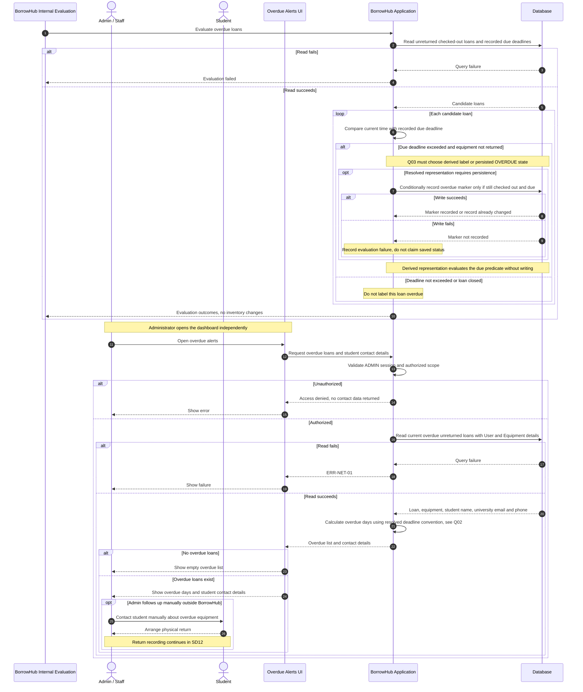

FR-025 يمنع الحظر الآلي بسبب التأخير وحده، ولا يلغي حد الطلبين وبقية التحققات في SD07. لا بريد آلي أو غرامة أو تعليق آلي. تمثيل OVERDUE لا يغيّر borrowed_quantity؛ المعدات ما زالت لدى الطالب.

## SD15 — استعراض لوحة الإدارة

**المراجع:** PRD §14، Admin Portal 5، UC19. قراءة مؤشرات مؤكدة فقط؛ لا شاشة تحليلات موسعة أو تصدير أو عرض سجل التدقيق.

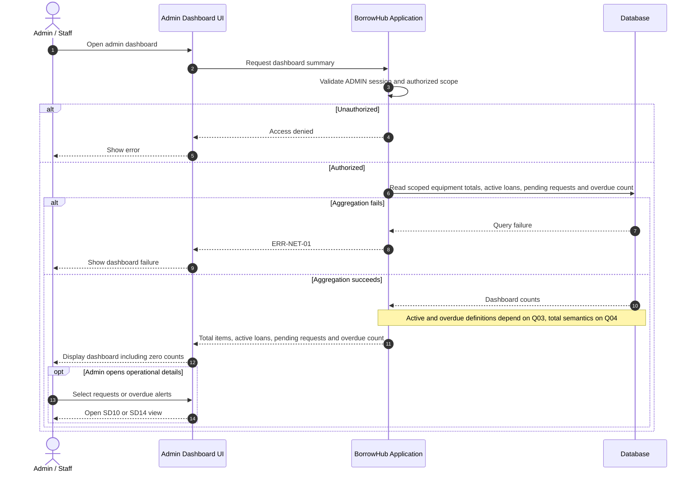

## مراجعة الاتساق والتحقق

- تغطية FR-001–025 تظهر في جدول التحليل، إما كسلوك أو شرط. UC23 وUC24 داخل العمليات التي تحتاجهما. كل رسم مستقل يبدأ بـ`sequenceDiagram` ويمكن نسخه إلى Mermaid.
- لا حجز عند تقديم الطلب أو إلغائه قبل المراجعة؛ الاعتماد يحجز، والتسليم ينقل المحجوز للمستعار، والإرجاع يوجه للمناسب، والانتهاء يعيد المحجوز للمتاح.
- لا استجابة نجاح لعمليات المخزون قبل COMMIT؛ فشل المعاملة لا يترك تحديثاً جزئياً. فشل الاستجابة بعد COMMIT يعالج بقراءة الحالة الحالية قبل إعادة المحاولة.
- سجل التدقيق المطلوب للاعتماد والتسليم والإرجاع/التلف يظهر في المعاملة نفسها. لا يفترض الرسم واجهة إدارة سجل أو مزود تدقيق منفصلاً.
- اجتازت المخططات الخمسة عشر محلل Mermaid **11.17.2**، مع فحص أن جميع مرسلي الرسائل ومستقبليها مشاركون معلنون. أدوات التحقق مؤقتة خارج المشروع؛ لم تُضف تبعيات أو كود تطبيق. لم يُختبر العرض البصري في متصفح أو إضافة IDE.
- قيود الأعمال المفتوحة أعلاه تحتاج قرارات قبل التنفيذ. صحة صياغة Mermaid لا تحسمها، وغياب ERD/DBML يمنع تأكيد أسماء الأعمدة والعلاقات الفيزيائية.
