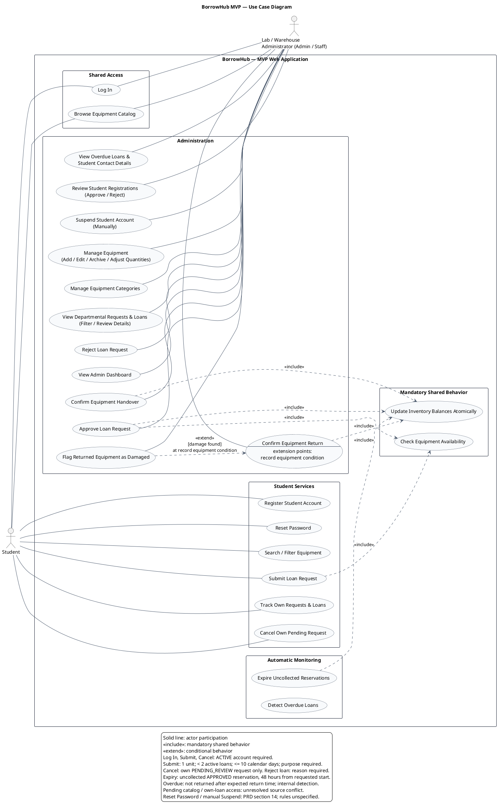

# مخطط حالات الاستخدام — BorrowHub MVP

## العنوان والغرض

**BorrowHub MVP — Use Case Diagram**

يوضح هذا المخطط وظائف تطبيق الويب، ومن يملك صلاحية استخدامها، وحدود النظام، والسلوك المشترك الإلزامي والسلوك المشروط. يعتمد تحليل المتطلبات حصراً على [وثيقة PRD، الإصدار 1.0.0](../PRD.md) و[تدفق المستخدم](../user-flow.md). الإحالات أدناه تستخدم أرقام أقسام الوثيقتين ومعرّفات المتطلبات الأصلية.

هذا مخطط حالات استخدام واحد؛ الخطوط لا تمثل ترتيب خطوات دورة الإعارة أو انتقالات الحالات. جُمعت العمليات المتقاربة تحت هدف واحد حيث لا يغيّر ذلك الصلاحيات أو قواعد الأعمال. أسماء الحالات داخل الرسم بالإنجليزية، وشرحها وتوثيقها بالعربية.

## حدود النظام ونطاق الـMVP

يمثل المستطيل الخارجي **BorrowHub — MVP Web Application**. تشمل حدوده الحسابات، الكتالوج والمخزون التجميعي، طلبات الإعارة، تسجيل التسليم والإرجاع، لوحات المتابعة، والانتهاء التلقائي للحجوزات وكشف التأخير.

فحص الهوية والمعدة فعلياً، وتسليمها واستلامها، ومطابقة سجلات الجامعة والتواصل الهاتفي اليدوي أنشطة خارج تطبيق الويب. يدعم التطبيق هذه الأنشطة بعرض البيانات وتسجيل القرارات والنتائج؛ لا يفترض المخطط اتصالاً إلكترونياً بالجامعة أو خدمة اتصالات.

التكاملات الخارجية غير موجودة في الـMVP وفق PRD §17. لا يشمل الرسم SSO، بوابات الدفع والغرامات، الرسائل الآلية، الحظر الآلي، التتبع بالرقم التسلسلي، مسح الباركود/QR، أو تطبيقات الهاتف الأصلية؛ هذه مستبعدة في PRD §4 و§9 و§24.

## الممثلون ومسؤولياتهم

| الممثل | التصنيف | المسؤوليات والصلاحيات المؤكدة | المرجع |
| --- | --- | --- | --- |
| الطالب — Student | ممثل أساسي | إنشاء الحساب، تسجيل الدخول للحساب النشط، استعادة كلمة المرور المذكورة في شاشة الطالب، تصفح المعدات والبحث فيها، تقديم الطلب ومتابعة طلباته وإعاراته وإلغاء طلبه المعلّق وفق القيود. | PRD §5، FR-001–005، FR-011–016، §14–15؛ تدفق المستخدم §3.1 |
| مسؤول المعمل/المستودع — Admin / Staff | ممثل أساسي | مراجعة التسجيلات وتفعيلها أو رفضها، التعليق اليدوي المذكور في شاشة الإدارة، إدارة المعدات والفئات والكميات، مراجعة طلبات القسم واعتمادها أو رفضها، تسجيل التسليم والإرجاع والتلف، ومتابعة اللوحات والمتأخرين وبيانات التواصل. لا يستعير لنفسه في الـMVP. | PRD §5، FR-004، FR-006–010، FR-017–024، §14–15، DEC-05؛ تدفق المستخدم §3.2 |

**الممثلون الثانويون:** لا تؤكد الوثيقتان وجود ممثل خارجي ثانوي. المسؤول يساند هدف الطالب تجارياً، لكنه يبدأ أهدافاً إدارية بنفسه ولذلك صُنّف ممثلاً أساسياً أيضاً. لا توجد أدوار مستقلة مؤكدة للضيف، أو مدير أعلى، أو موظف بصلاحيات مختلفة.

**تعميم الممثلين:** لم يُستخدم. Admin وStaff تسميتان للدور نفسه في المصدر، وليسا مستويين في هرم صلاحيات. Pending وApproved حالتان للحساب وليستا دورين منفصلين؛ تُعبَّر قيودهما بالشروط، مع إبقاء تعارض الوصول قيد السؤال Q01.

**النظام ليس ممثلاً لنفسه:** ورود «System» في تدفق المستخدم يصف مسؤوليات داخلية. الانتهاء التلقائي وكشف التأخير داخل الحدود دون اختراع ممثل «مؤقت» أو خدمة جدولة خارجية.

## حالات الاستخدام وتتبّع المتطلبات

كل معرّف في الجدول يطابق alias في ملف PlantUML. «سلوك داخلي» يعني أنه يُنفّذ داخل BorrowHub، ولا يمنح ممثلاً بشرياً إجراءً جديداً.

| المعرّف | حالة الاستخدام | الممثل/المستفيد | النتيجة والقيود | المصدر |
| --- | --- | --- | --- | --- |
| UC01 | إنشاء حساب طالب — Register Student Account | الطالب | الاسم الكامل، البريد الجامعي، الرقم الجامعي، القسم، الهاتف النشط وكلمة المرور؛ الحساب يبدأ بـPENDING_APPROVAL. حقل القسم منصوص عليه في FR-001 ولو غاب عن وصف التسجيل المختصر. | FR-001–002، EC-03؛ تدفق المستخدم §3.1 |
| UC02 | تسجيل الدخول — Log In | الطالب، المسؤول | البريد وكلمة المرور؛ صلاحية الدخول للحساب النشط وفق FR-005. وصول الحساب المعلّق يحتاج حسم Q01. | FR-005، PRD §13؛ تدفق المستخدم §3.1–3.2 |
| UC03 | إعادة تعيين كلمة المرور — Reset Password | الطالب | مذكورة صراحة في شاشة الطالب، دون افتراض بريد آلي أو رمز تحقق أو تدخل مسؤول. الآلية وصلاحية المسؤول مفتوحتان في Q06. | PRD §14، Student Portal 1 |
| UC04 | مراجعة تسجيلات الطلاب واعتمادها أو رفضها — Review Student Registrations | المسؤول | عرض التسجيلات المعلّقة وبيانات الطالب، ثم قرار التفعيل ACTIVE أو الرفض REJECTED بعد التحقق اليدوي. لا يُفترض سبب رفض تسجيل إلزامي. | FR-004، US-02، PRD §13.2؛ تدفق المستخدم §3.2 |
| UC05 | تعليق حساب طالب يدوياً — Suspend Student Account | المسؤول | إجراء Suspend وارد في شاشة إدارة المستخدمين. لا تُفترض أسبابه أو مدته أو إعادة التفعيل أو تأثيره على الإعارات، ولا يُربط تلقائياً بالتأخير. | PRD §14، Admin Portal 6؛ انظر Q07 |
| UC06 | تصفح كتالوج المعدات — Browse Equipment Catalog | الطالب، المسؤول | الاطلاع على المعدات والأرصدة المتاحة. العلاقة مع الطالب عامة ولا تحسم وصول الطالب المعلّق أو عرض المعدات ذات الرصيد صفر؛ انظر Q01. | UN-STU-01، FR-011، PRD §13.1 و§15 |
| UC07 | البحث عن المعدات وتصفيتها — Search / Filter Equipment | الطالب | البحث والتصفية بالفئة أثناء استعراض الكتالوج. ليست خطوة إلزامية لتقديم طلب. | PRD §14، Student Portal 2؛ تدفق المستخدم §3.1 |
| UC08 | إدارة المعدات — Manage Equipment | المسؤول | عرض بيانات المعدات وإضافتها وتعديلها وأرشفتها وتعديل الكميات التجميعية. لا يستبدل الرسم الأرشفة بحذف المعدات. | FR-006–007، UN-ADM-02، PRD §13.2 و§14؛ تدفق المستخدم §3.2 |
| UC09 | إدارة فئات المعدات — Manage Equipment Categories | المسؤول | عمليات CRUD للفئات كما وردت في شاشة المخزون. شروط الحذف والمعدات المرتبطة غير محددة. | PRD §14، Admin Portal 7؛ تدفق المستخدم §3.2 |
| UC10 | تقديم طلب استعارة — Submit Loan Request | الطالب | حساب ACTIVE؛ وحدة واحدة؛ أقل من طلبين نشطين؛ مدة ≤10 أيام تقويمية؛ غرض غير فارغ؛ تحقق التوفر؛ حفظ PENDING_REVIEW دون حجز مخزون. | FR-003، FR-011–015، AC-01، DEC-01–02؛ تدفق المستخدم §4 |
| UC11 | متابعة الطلبات والإعارات الشخصية — Track Own Requests & Loans | الطالب | الحالات، المعلّق والنشط والسابق والمتأخر، موعد الإرجاع، مهلة الاستلام، وسبب رفض الطلب داخل المنصة. لا يطّلع الطالب على إعارات الآخرين. | UN-STU-03–04، PRD §13.1 و§14–15؛ تدفق المستخدم §3.1 |
| UC12 | إلغاء الطلب الشخصي المعلّق — Cancel Own Pending Request | الطالب | لحساب الطالب المعتمد وطلبه الذي ما زال PENDING_REVIEW فقط؛ يتحول إلى CANCELLED دون تغيير المخزون. | FR-016، AC-07، PRD §15، DEC-03؛ تدفق المستخدم §4 |
| UC13 | استعراض طلبات وإعارات القسم — View Departmental Requests & Loans | المسؤول | قوائم الطلبات والإعارات، التصفية بالحالة، تفاصيل الطالب والغرض والتواريخ، ومراجعة قائمة الطلبات المعلّقة. | UN-ADM-03، PRD §13.2 و§14–15؛ تدفق المستخدم §3.2 |
| UC14 | اعتماد طلب استعارة — Approve Loan Request | المسؤول | اعتماد الطلب المعلّق بعد فحص التوفر؛ حجز وحدة فور الموافقة بعملية ذرية؛ فشل الاعتماد عند نفاد الرصيد. | FR-008، FR-017، AC-02، ERR-ACT-01 |
| UC15 | رفض طلب استعارة — Reject Loan Request | المسؤول | حفظ REJECTED مع سبب رفض إلزامي يظهر للطالب؛ دون تخصيص مخزون. | FR-017، PRD §13.1–13.2؛ تدفق المستخدم §3.2 |
| UC16 | تأكيد تسليم المعدة — Confirm Equipment Handover | المسؤول | تسجيل التسليم الفعلي لطلب APPROVED بعد التحقق اليدوي من الهوية؛ CHECKED_OUT ونقل المحجوز إلى المستعار وتسجيل الوقت. موعد الاستحقاق يحتاج Q02. | FR-008، FR-019–020، AC-03؛ تدفق المستخدم §3.2 |
| UC17 | تأكيد إرجاع المعدة — Confirm Equipment Return | المسؤول | تسجيل الإرجاع بفعل واحد بعد الفحص الفعلي؛ تسجيل الوقت وإغلاق الإعارة وتحديث المخزون بحسب حالة المعدة. إرجاع المتأخر وتسمية حالة الإرجاع التالف يحتاجان Q03 وQ05. | FR-009–010، FR-020–022، AC-04–05؛ تدفق المستخدم §3.2 |
| UC18 | تسجيل المعدة المرتجعة كتالف — Flag Returned Equipment as Damaged | المسؤول | سلوك مشروط أثناء الإرجاع عند وجود تلف؛ يزيد رصيد التالف ويقل المستعار دون إعادة الوحدة للمتاح. ملاحظات الضرر وحساب الإجمالي يحتاجان Q04–05. | FR-010، FR-022، AC-05؛ تدفق المستخدم §3.2 |
| UC19 | استعراض لوحة الإدارة — View Admin Dashboard | المسؤول | إجمالي المعدات، الإعارات النشطة، الطلبات المعلّقة، وعدد الإعارات المتأخرة. | PRD §14، Admin Portal 5؛ تدفق المستخدم §3.2 |
| UC20 | استعراض المتأخرين وبيانات التواصل — View Overdue Loans & Student Contact Details | المسؤول | قائمة المتأخرين، المعدة، أيام التأخير، اسم الطالب، هاتفه وبريده؛ تمكين المتابعة اليدوية خارج المنصة. | F-05، FR-024، SEC-03، AC-06؛ تدفق المستخدم §3.2 |
| UC21 | إنهاء الحجوزات غير المستلمة — Expire Uncollected Reservations | سلوك داخلي؛ يستفيد منه مستخدمو المخزون | انتهاء حجز APPROVED لم يُستلم خلال 48 ساعة من تاريخ البدء، وحفظ EXPIRED وتحرير المحجوز. لا يُفترض منتج جدولة خارجي. | FR-018، AC-08، EC-06، DEC-04؛ تدفق المستخدم §4 |
| UC22 | كشف الإعارات المتأخرة — Detect Overdue Loans | سلوك داخلي؛ يستفيد منه الطالب والمسؤول | كشف تجاوز expected_return_at لمعدة لم تُعد، وإظهار التأخير داخل لوحات المنصة. تمثيل OVERDUE كحالة أو وسم يحتاج Q03. | FR-023، AC-06، PRD §13.1؛ تدفق المستخدم §3.1–3.2 |
| UC23 | فحص توفر المعدة — Check Equipment Availability | سلوك مشترك داخلي | التحقق من available_quantity > 0 عند تقديم الطلب وعند الاعتماد؛ الفحص عند التقديم لا يحجز الوحدة. | FR-008، FR-011، EC-01، ERR-INV-01 وERR-ACT-01؛ تدفق المستخدم §1 |
| UC24 | تحديث أرصدة المخزون ذرياً — Update Inventory Balances Atomically | سلوك مشترك داخلي | حجز الوحدة أو تسليمها أو إعادتها أو تحرير الحجز المنتهي وفق العملية؛ نجاح الاعتماد يتطلب فحصاً وحجزاً في المعاملة الذرية نفسها. | FR-008–010، FR-018، NFR-002، AC-02–05 وAC-08 |

**درجة اكتمال التوثيق:** UC03 وUC05 وCRUD الفئات في UC09 ليست وظائف مستنتجة؛ وردت صراحة في PRD §14. تفاصيلها التشغيلية أقل اكتمالاً من متطلبات الإعارة، ولذلك لم تُضف لها آليات أو شروط غير موثقة.

## العلاقات ودلالتها

### الارتباط بالممثلين

تربط الخطوط المتصلة كل ممثل بالوظائف التي يشارك في استخدامها. تبقى صلاحيات الطالب محصورة في طلباته وإعاراته، وتبقى الموافقة والرفض الإداري والتسليم والإرجاع والتلف وإدارة المخزون والمتأخرين للمسؤول. علاقة المسؤول بالكتالوج منصوص عليها في جدول PRD §15.

لم يُربط الطالب بتأكيد التسليم أو الإرجاع داخل التطبيق؛ الطالب يحضر ويسلم المعدة فعلياً، بينما المسؤول يسجل العملية. لم يُربط المسؤول بتقديم طلب أو إلغاء طلب شخصي؛ DEC-05 وجدول الصلاحيات لا يمنحانه الاقتراض.

### علاقات «include» الإلزامية

يتجه السهم المتقطع من الحالة الأساسية إلى السلوك المشترك المطلوب.

| الحالة الأساسية | الحالة المضمّنة | سبب الإلزام |
| --- | --- | --- |
| UC10 تقديم طلب، وUC14 اعتماد طلب | UC23 فحص التوفر | يلزم الفحص في كل محاولة؛ إعادة الفحص عند الاعتماد تمنع اعتماد طلب على رصيد استهلكه طلب آخر. |
| UC14 اعتماد طلب | UC24 تحديث الأرصدة ذرياً | الاعتماد الناجح يحجز وحدة فوراً. |
| UC16 تأكيد التسليم | UC24 تحديث الأرصدة ذرياً | تنتقل الوحدة من المحجوز إلى المستعار. |
| UC17 تأكيد الإرجاع | UC24 تحديث الأرصدة ذرياً | ينخفض المستعار وتحدد حالة المعدة الحساب الذي تضاف إليه الوحدة. |
| UC21 إنهاء حجز غير مستلم | UC24 تحديث الأرصدة ذرياً | يحرر الحجز المنتهي الوحدة المحجوزة. |

فحص التوفر والتخصيص في UC14 جزءان من **معاملة ذرية واحدة**؛ تفكيكهما بصرياً لا يسمح بفصل التحقق عن الحجز في التنفيذ. `include` لا يعني أن كل محاولة تنجح؛ يمكن أن تنتهي بخطأ موثق.

لم يُستخدم تسجيل الدخول كـ`include` لكل وظيفة: الجلسة والصلاحيات شروط مسبقة، ولا يتكرر تسجيل الدخول في كل عملية. لم تُفصل حقول النموذج والطوابع الزمنية وسجل التدقيق إلى حالات مستقلة؛ هي قيود أو نتائج للعمليات الأصلية، وليست أهداف مستخدم منفصلة.

### علاقة «extend» المشروطة

**UC18 تسجيل التلف → UC17 تأكيد الإرجاع** عند الشرط **[وجود تلف]** ونقطة الامتداد **record equipment condition**. الإرجاع السليم مكتمل دون هذه الإضافة. عند وجود تلف، تحدد الإضافة نتيجة فحص الحالة قبل تنفيذ تحديث الأرصدة، فيضاف إلى التالف بدلاً من المتاح؛ لا تُنفّذ إعادة إلى المتاح ثم تخصم مرة أخرى.

تأكيد الإرجاع يتضمن UC24 في الحالتين؛ UC18 لا ينفّذ تحديثاً إضافياً مستقلاً. لم يُستخدم `extend` بين الإلغاء وتقديم الطلب، أو الانتهاء التلقائي والموافقة، أو التأخير والتسليم: هذه أحداث لاحقة وليست إضافات تنفذ داخل الحالة الأساسية.

البحث والتصفية وظيفة من الكتالوج مرتبطة بالطالب مباشرة، دون فرض علاقة `include` أو `extend` لا تحتاجها القراءة.

## مصدر PlantUML

النسخة الخام محفوظة في [use-case.puml](use-case.puml). الكود التالي مطابق لها.



## شرح المخطط بالعربية

يبدأ دور الطالب بإنشاء حساب ينتظر التحقق الإداري. بعد تفعيل الحساب يمكنه تقديم طلب لمعدة متاحة، بكمية ثابتة هي وحدة واحدة، وبحد أقصى طلبين نشطين ومدة لا تتجاوز عشرة أيام تقويمية، مع كتابة غرض الاستخدام. يتابع الطالب القرار والمواعيد داخل المنصة، ويستطيع إلغاء طلبه المعلّق فقط.

يراجع المسؤول بيانات التسجيلات وطلبات القسم. الموافقة على طلب الاستعارة تحجز الوحدة فوراً؛ الطلب المعلّق لا يحجزها. عند حضور الطالب يسجل المسؤول التسليم الفعلي، وعند الإرجاع يسجل النتيجة بعد فحص المعدة. تسجيل التلف امتداد مشروط للإرجاع، وليس خطوة مطلوبة لكل إرجاع.

تعرض لوحة الإدارة مؤشرات التشغيل، وتعرض قائمة التأخير بيانات الاتصال اللازمة للمتابعة اليدوية. ينهي النظام الحجوزات التي لم تُستلم في المهلة ويكشف تجاوز موعد الإرجاع تلقائياً. لا تمنح هذه العمليات النظام دور ممثل خارجي، ولا تنشئ خدمة رسائل أو حظراً تلقائياً.

يجمع الرسم إضافة المعدات وتعديلها وأرشفتها وضبط كمياتها تحت «إدارة المعدات»، ويجمع عرض التسجيلات واتخاذ قرار اعتمادها أو رفضها تحت «مراجعة تسجيلات الطلاب». يعرض الاعتماد والرفض في طلبات الإعارة منفصلين لأن أثر المخزون وسلوك فحص التوفر يختلفان.

## المتطلبات الناقصة والأسئلة المفتوحة

وجود حالة استخدام لا يحسم التفاصيل غير المذكورة لها. البنود التالية تمنع تحويل التوثيق إلى قواعد أعمال مفترضة:

| السؤال | التعارض أو النقص في المصدر | المطلوب حسمه وأثره على الرسم |
| --- | --- | --- |
| Q01 — وصول الحساب المعلّق والكتالوج | PRD §15 يسمح للطالب المعلّق بعرض الكتالوج وإعاراته؛ FR-005 و§13 وتدفق الطالب تعرض الدخول/البوابة للحساب ACTIVE، وFR-011 يذكر الطالب المعتمد. FR-011 يعرض المتاح فقط، بينما §13 يعرض إجراء الطلب معطلاً عند نفاد المخزون. | كيف يصل المعلّق إلى الصفحات المسموح بها؟ وهل تظهر المعدات غير المتاحة؟ ارتباط Student بـUC06 وUC11 يعبر عن الدور دون حسم حالة الحساب؛ لا يُستنتج وصول ضيف. |
| Q02 — حساب موعد الإرجاع والمهل | FR-012 وDEC-02 وقواعد التدفق تحسب المدة من تاريخ البدء المطلوب؛ AC-03 وPRD §13 والتدفق تبدأ عداد الإرجاع عند التسليم. البيانات تخلط expected_return_date وexpected_return_at. | هل الموعد ثابت من تاريخ البدء المطلوب أم يعاد حسابه عند التسليم، خصوصاً عند التأخر في الاستلام؟ ما حد اليوم والمنطقة الزمنية للحساب؟ لم يحسم UC16 أو UC22 الصيغة. |
| Q03 — حالة التأخير والإرجاع والحصة | FR-023 وAC-06 يذكران OVERDUE؛ FR-021 وEC-04 يقصران الإرجاع على CHECKED_OUT، بينما تدفق المسؤول يسمح CHECKED_OUT / OVERDUE. FR-014 وDEC-01 لا يذكران OVERDUE ضمن الحصة. قائمة §16 تغفل CANCELLED وEXPIRED الموثقتين وظيفياً. | هل التأخير وسم فوق CHECKED_OUT أم حالة مستقلة؟ إن كان حالة، كيف يُعاد المتأخر وهل يحسب ضمن الطلبين؟ يجب توحيد الحالات. FR-025 يؤكد عدم المنع التلقائي بسبب التأخير، لكنه لا يلغي بقية الحدود. |
| Q04 — إجمالي المخزون التالف | US-08 وEC-02 يذكران خصم total_quantity، بينما FR-010 وAC-05 والتدفق يوضحون زيادة التالف وخفض المستعار دون استعادة المتاح ولا يحددون أثر الإجمالي. | هل يشمل الإجمالي التالف أم يستبعده؟ كيف تُحفظ اتساقات الأرصدة؟ UC24 يعرض التحديثات المتفق عليها دون افتراض معادلة للإجمالي. |
| Q05 — حالة الإرجاع التالف وملاحظاته | F-04 وFR-010 وFR-022 وبعض عبارات التدفق تستخدم DAMAGED؛ AC-05 وتدفق المسؤول يغلقان الإعارة كـRETURNED مع التلف. FR-022 يجعل الملاحظات اختيارية، بينما تدفق المسؤول §3.2 يجعلها إلزامية. | هل DAMAGED حالة المعدة أم الإعارة أم علامة منفصلة؟ وهل ملاحظات التلف مطلوبة؟ لا يفرض UC18 كتابة الملاحظات ولا حالة نهائية متعارضة. |
| Q06 — استعادة كلمة المرور | مذكورة في PRD §14 فقط، مع غياب مسار التحقق والاستعادة؛ لا توجد تكاملات في §17 والرسائل الآلية مؤجلة في §9. | ما آلية إثبات الهوية وإعادة التعيين؟ وهل تشمل المسؤول؟ أُدرج UC03 للطالب دون ممثل بريد أو SMS ودون ربطه بتسجيل الدخول كامتداد. |
| Q07 — التعليق اليدوي للحساب | PRD §14 يذكر Suspend للمسؤول، لكن حالات الحساب في §16 هي PENDING_APPROVAL / ACTIVE / REJECTED ولا توجد قواعد تعليق؛ المستبعد صراحة هو التعليق الآلي. | ما أسباب التعليق، مدته، حالته، وآثاره على الجلسة والطلبات والإعارات القائمة؟ هل توجد إعادة تفعيل؟ UC05 يثبت الإجراء المذكور فقط ولا يضيف إجراء إعادة تفعيل. |
| Q08 — إدارة الفئات والكميات والأرشفة | PRD §14 يذكر CRUD للفئات وتعديل الكميات، وFR-006 يذكر أرشفة المعدات؛ لا توجد قواعد للمعدات المرتبطة أو وحدات محجوزة/مستعارة عند التعديل. | ما قيود حذف الفئة، خفض الإجمالي، وأرشفة معدة لها طلبات أو إعارات قائمة؟ يبقى UC08 وUC09 دون افتراض حذف معدات أو تحرير حجوزات. |
| Q09 — إلغاء الحجز المعتمد وتمديد الإعارة | FR-008 يصف رد المخزون إذا أُلغي حجز معتمد، لكنه لا يمنح ممثلاً إجراء إلغاء؛ تدفق المستخدم §5 يسأل عن الإلغاء الإداري والتمديد دون تأكيدهما. | هل يوجد إلغاء يدوي بعد الاعتماد أو تعديل لموعد الإرجاع؟ لم تُضف لهما حالات استخدام؛ الطالب يلغي PENDING_REVIEW فقط والانتهاء التلقائي مؤكد. |
| Q10 — تواريخ الحجز المتاحة | start_date ومهلة الاستلام موثقان، دون قواعد حجز بتاريخ ماضٍ أو التسليم المبكر أو اعتماد طلب بعد انقضاء نافذته. | ما التواريخ المقبولة ومتى يصبح التسليم أو الاعتماد مسموحاً؟ لا يتضمن الرسم تقويماً لحجز فترات زمنية أو قواعد جديدة. |
| Q11 — فشل الاعتماد بسبب المخزون | FR-017 وERR-ACT-01 يقرران رفض محاولة الاعتماد لنفاد المخزون؛ بعض أسهم التدفق تنتقل مباشرة إلى سبب الرفض، بينما شرح الأخطاء يسمح «رفض أو انتظار». | هل يبقى الطلب PENDING_REVIEW أم يجب اتخاذ قرار رفض مستقل؟ UC14 يثبت فشل الاعتماد، ولا ينفذ UC15 آلياً. |
| Q12 — إنشاء حساب المسؤول والحساب المرفوض | التسجيل في FR-001 للطالب فقط؛ لا يوجد مسار إنشاء/تهيئة حساب ADMIN أو قواعد إعادة تقديم تسجيل مرفوض. | كيف يجهّز حساب المسؤول الأول، وكيف يعالج التسجيل المرفوض؟ لم تُفترض صلاحيات تسجيل ذاتي للمسؤول أو تعديل دور الحساب. |
| Q13 — التحليلات وسجل التدقيق | PRD §21 يحدد مؤشرات AN-01–04، وNFR-008 يلزم التسجيل، دون تأكيد شاشة تقارير أو صلاحية قراءة السجل أو تصديره. | هل تحتاج المؤشرات إلى واجهة ضمن الـMVP، ولأي ممثل؟ لم تُخترع شاشة تقارير/تصدير أو استعراض سجل؛ UC19 يغطي المؤشرات المحددة صراحة في لوحة الإدارة فقط. |
| Q14 — فقد المعدة | عنوان UN-ADM-06 يذكر الضرر والفقد، لكن FR-010 وFR-022 ومسار الإرجاع يحددان التلف فقط. | هل توجد معالجة مستقلة لمعدة مفقودة؟ ما أثرها على الإعارة والمخزون؟ لم تُضف حالة «تسجيل فقد» لغياب قواعد مؤكدة. |

**نقطتان محسومتان بالنص وليستا افتراضاً:**

- الحجز يتم فور الموافقة حتى لو كان تاريخ البدء مستقبلياً، وفق FR-008 وAC-02. السؤال المقابل في تدفق المستخدم §5.2 تجيبه الوثيقة؛ لم يُؤجل تخصيص المخزون إلى تاريخ البدء.
- كمية الطلب ثابتة عند وحدة واحدة وفق FR-014 وقواعد التدفق، رغم ذكر «Quantity selector» في PRD §14. لم يُفترض السماح بعدة وحدات.

## مراجعة الاتساق والتحقق

- **التغطية:** تغطي القائمة متطلبات FR-001–025 بوصفها أهدافاً أو قيوداً أو سلوكاً داخلياً، مع صفحات البحث والتصفية والفئات ولوحات المتابعة. لم تُسقط إعادة التعيين أو التعليق اليدوي المذكورين في الشاشات، وتم تمييز نقص تفاصيلهما.
- **الصلاحيات:** إجراء الطلب والإلغاء للطالب المعتمد وعلى بياناته فقط؛ القرار الإداري والمخزون والتسليم والإرجاع والتلف والمتأخرون للمسؤول؛ لا اقتراض للمسؤول، ولا عرض الطالب لإعارات القسم.
- **العلاقات:** ست علاقات include لسلوك إلزامي مشترك، وعلاقة extend واحدة للتلف أثناء الإرجاع. لا أسهم دورة حياة ولا تعميم ممثلين غير مبرر.
- **حدود الـMVP:** لا ممثل أو تكامل خارجي، ولا ميزة من قائمة Post-MVP. استعادة كلمة المرور لا تفترض وسيلة رسائل، والتعليق يدوي فقط.
- **قواعد الحماية:** فحص الصلاحيات والمدخلات، أمان كلمة المرور والجلسة، المعاملات الذرية، الطوابع الزمنية وسجل التدقيق متطلبات على العمليات؛ لا تعني إضافة واجهات إدارية غير موثقة. انظر NFR-002 وNFR-005–008، FR-020 وSEC-01–04.
- **عدم حسم التعارضات:** الأسئلة أعلاه تبقى مفتوحة؛ سلامة صياغة الرسم لا تعني أن تفاصيل الأعمال المتعارضة قد حُسمت.
- **تطابق النسخ:** اجتاز فحص التطابق الحرفي بين مقطع PlantUML المضمّن والملف الخام. تحققت أيضاً معرّفات الحالات الـ24، ارتباطات صلاحيات الممثلين، اتجاهات العلاقات، والأسئلة الـ14.
- **التحقق الآلي والبصري:** اجتاز المصدر محلل PlantUML **1.2026.8** بالأمر `--check-syntax`، ورُسم محلياً بمحرك Smetana وراجعتُ المعاينة. جُمعت الحالات حسب الممثل والسلوك الداخلي لتقليل ازدحام الروابط؛ صور المعاينة محفوظة خارج المشروع للتحقق فقط.

لإعادة الفحص والرسم من جذر المشروع، مع استبدال مسار ملف JAR بموقعه لديك:

```bash
java -Djava.awt.headless=true -jar /path/to/plantuml.jar --check-syntax docs/diagrams/use-case.puml
java -Djava.awt.headless=true -jar /path/to/plantuml.jar -Playout=smetana -tpng docs/diagrams/use-case.puml
```

استُخدم [مرجع PlantUML الرسمي لحالات الاستخدام](https://plantuml.com/use-case-diagram) للصياغة فقط، و[مرجع سطر الأوامر](https://plantuml.com/command-line) للتحقق؛ لا يضيفان متطلبات إلى المنتج.
