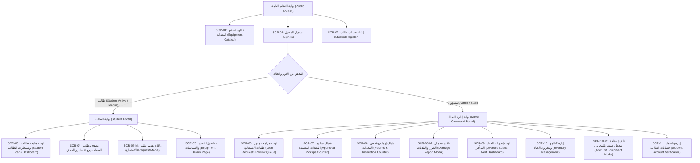

# خريطة الموقع وهيكل الصفحات (BorrowHub Sitemap)

## 1. الهيكل العام للتنقل والوصول (Navigation Structure & Access Hierarchy)

---

## 2. مصفوفة الصفحات ونموذج الصلاحيات (Sitemap Routing & Permissions Matrix)

| معرف الشاشة (ID) | اسم الشاشة (Screen Name) | مسار الرابط (Route Path) | الدور المسموح (Role) | شروط الوصول الإضافية |
| :--- | :--- | :--- | :--- | :--- |
| **SCR-01** | تسجيل الدخول (Sign In) | `/login` | Public / All | متاحة للجميع؛ تحول المسجل تلقائياً |
| **SCR-02** | تسجيل حساب طالب جديد (Registration) | `/register` | Public / Guest | متاحة للزوار غير المسجلين |
| **SCR-03** | استعاراتي ومتابعة الطلبات (My Loans) | `/my-loans` | Student | تتطلب تسجيل الدخول كطالب |
| **SCR-04** | كتالوج المعدات المتاحة (Equipment Catalog) | `/catalog` أو `/` | Public + Student | التصفح عام؛ الطلب يتطلب `ACTIVE` |
| **SCR-05** | تفاصيل المعدة ومواصفاتها (Item Details) | `/catalog/:id` | Public + Student | التصفح عام؛ الطلب يتطلب `ACTIVE` |
| **SCR-06** | طابور مراجعة الطلبات (Request Reviews) | `/admin/requests` | Admin / Staff | وصول محمي للمسؤولين |
| **SCR-07** | شباك التسليم الفعلي (Pickup Counter) | `/admin/pickups` | Admin / Staff | وصول محمي للمسؤولين |
| **SCR-08** | شباك الإرجاع والمعاينة (Returns Counter) | `/admin/returns` | Admin / Staff | وصول محمي للمسؤولين |
| **SCR-09** | لوحة إنذارات التأخير (Overdue Alerts) | `/admin/overdue` | Admin / Staff | وصول محمي للمسؤولين |
| **SCR-10** | إدارة المخزون والعتاد (Inventory) | `/admin/inventory` | Admin / Staff | وصول محمي للمسؤولين |
| **SCR-11** | اعتماد حسابات الطلاب (User Management) | `/admin/users` | Admin / Staff | وصول محمي للمسؤولين |

---

## 3. مسارات التنقل السريع والروابط المترابطة (Inter-Screen Navigation)
- **من الكتالوج (SCR-04) إلى الطلب:** النقر على "طلب استعارة" يفتح نافذة الحجز مباشرة أو ينتقل إلى صفحة التفاصيل (SCR-05).
- **من طلباتي (SCR-03) إلى الكتالوج:** زر إجراء مباشر (CTA) عند فراغ القائمة يوجه الطالب للكتالوج للبدء في الاستعارة.
- **من طابور الاعتماد (SCR-06) إلى التسليم (SCR-07):** بعد موافقة المسؤول، يتحول الطلب مباشرة لشباك التسليم مع ظهور إشعار توجيهي.
- **من لوحة المتأخرات (SCR-09) إلى شباك الإرجاع (SCR-08):** النقر على بطاقة الطالب المتأخر يتيح للمسؤول فتح نافذة الإرجاع السريع عند حضوره لمكتب الخدمة.
