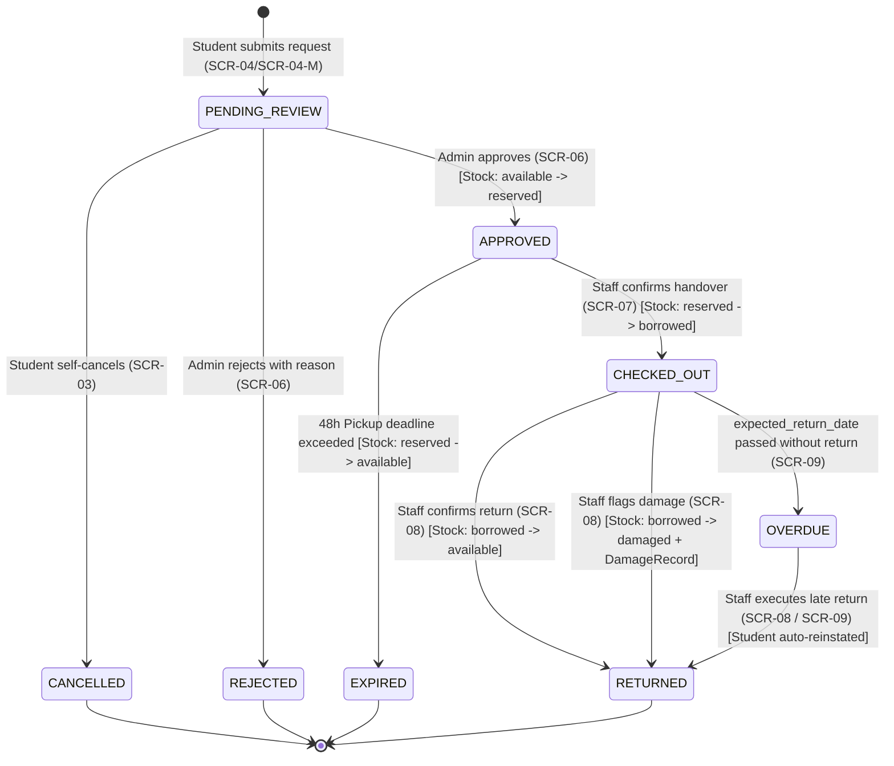

# Data Model: BorrowHub Equipment Borrowing Management Platform

**Feature Branch**: `001-equipment-borrowing-ui`  
**Date**: 2026-10-15  
**Reference**: `docs/database.dbml`, `docs/ERD.md`, `specs/001-equipment-borrowing-ui/spec.md`

---

## 1. Entity Definitions & Schemas

### 1.1 User (`users`)
Represents students, laboratory administrators, and counter staff.

| Field | Type | Modifiers | Description |
|---|---|---|---|
| `id` | `UUID` | PK, default `gen_random_uuid()` | Unique user identifier |
| `email` | `VARCHAR(255)` | NOT NULL, UNIQUE | University institutional email address |
| `password_hash` | `VARCHAR(255)` | NOT NULL | Salted password hash (bcrypt / argon2) |
| `full_name` | `VARCHAR(255)` | NOT NULL | Full name in official university records |
| `student_id` | `VARCHAR(64)` | NULL, UNIQUE | University student matriculation number |
| `department` | `VARCHAR(128)` | NOT NULL | Academic faculty or department |
| `phone` | `VARCHAR(32)` | NOT NULL | Direct contact mobile phone number |
| `role` | `ENUM` | NOT NULL, default `'STUDENT'` | Options: `STUDENT`, `ADMIN` |
| `status` | `ENUM` | NOT NULL, default `'PENDING_APPROVAL'` | Options: `PENDING_APPROVAL`, `ACTIVE`, `REJECTED` |
| `rejection_reason` | `TEXT` | NULL | Admin explanation if account is rejected |
| `created_at` | `TIMESTAMPTZ` | NOT NULL, default `NOW()` | Account registration timestamp |
| `updated_at` | `TIMESTAMPTZ` | NOT NULL, default `NOW()` | Timestamp of last profile update |

**Validation Rules & Constraints**:
- `email`: Must be valid email format. Case-insensitive unique constraint.
- `student_id`: Required when `role = 'STUDENT'`. Unique across all users.
- `phone`: Required format validation (e.g. valid E.164 or campus domestic pattern).
- `role`: Admin accounts are manually seeded or promoted by existing administrators.

---

### 1.2 Category (`categories`)
Represents equipment groups (e.g., Laptops, Cameras, Projectors, Measurement Tools).

| Field | Type | Modifiers | Description |
|---|---|---|---|
| `id` | `UUID` | PK, default `gen_random_uuid()` | Unique category identifier |
| `name_ar` | `VARCHAR(128)` | NOT NULL, UNIQUE | Arabic category display name |
| `name_en` | `VARCHAR(128)` | NOT NULL, UNIQUE | English category display name |
| `slug` | `VARCHAR(128)` | NOT NULL, UNIQUE | URL-safe identifier |
| `created_at` | `TIMESTAMPTZ` | NOT NULL, default `NOW()` | Creation timestamp |

---

### 1.3 Equipment (`equipment`)
Represents physical equipment items managed in aggregate quantities.

| Field | Type | Modifiers | Description |
|---|---|---|---|
| `id` | `UUID` | PK, default `gen_random_uuid()` | Unique equipment identifier |
| `category_id` | `UUID` | NOT NULL, FK(`categories.id`) | Belongs-to category |
| `name_ar` | `VARCHAR(255)` | NOT NULL | Arabic item name |
| `name_en` | `VARCHAR(255)` | NOT NULL | English item name |
| `description_ar` | `TEXT` | NOT NULL | Arabic detailed technical specifications |
| `description_en` | `TEXT` | NOT NULL | English detailed technical specifications |
| `image_url` | `VARCHAR(512)` | NOT NULL | High-resolution equipment photo URL |
| `total_quantity` | `INTEGER` | NOT NULL, default 0, CHECK(`>= 0`) | Total departmental inventory count |
| `available_quantity` | `INTEGER` | NOT NULL, default 0, CHECK(`>= 0`) | Units on shelves ready for reservation |
| `reserved_quantity` | `INTEGER` | NOT NULL, default 0, CHECK(`>= 0`) | Approved units waiting for counter pickup |
| `borrowed_quantity` | `INTEGER` | NOT NULL, default 0, CHECK(`>= 0`) | Units currently handed over to students |
| `damaged_quantity` | `INTEGER` | NOT NULL, default 0, CHECK(`>= 0`) | Defective units decommissioned/in repair |
| `is_archived` | `BOOLEAN` | NOT NULL, default `false` | Soft-deletion flag |
| `created_at` | `TIMESTAMPTZ` | NOT NULL, default `NOW()` | Item addition timestamp |
| `updated_at` | `TIMESTAMPTZ` | NOT NULL, default `NOW()` | Last stock update timestamp |

**Stock Consistency Invariants**:
- Conservation rule: `total_quantity == available_quantity + reserved_quantity + borrowed_quantity + damaged_quantity`.
- Every stock column is constrained to `INTEGER >= 0`.

---

### 1.4 Loan (`loans`)
Represents an equipment checkout transaction from reservation to return.

| Field | Type | Modifiers | Description |
|---|---|---|---|
| `id` | `UUID` | PK, default `gen_random_uuid()` | Unique loan identifier |
| `user_id` | `UUID` | NOT NULL, FK(`users.id`) | Student requesting the loan |
| `equipment_id` | `UUID` | NOT NULL, FK(`equipment.id`) | Requested equipment item |
| `duration_days` | `INTEGER` | NOT NULL, CHECK(`BETWEEN 1 AND 10`) | Requested loan duration in calendar days |
| `academic_justification` | `TEXT` | NOT NULL | Purpose/course justification |
| `status` | `ENUM` | NOT NULL, default `'PENDING_REVIEW'` | Lifecycle state (see state machine below) |
| `requested_at` | `TIMESTAMPTZ` | NOT NULL, default `NOW()` | Submission timestamp |
| `approved_at` | `TIMESTAMPTZ` | NULL | Admin approval timestamp |
| `approved_by` | `UUID` | NULL, FK(`users.id`) | Admin who approved the request |
| `pickup_deadline` | `TIMESTAMPTZ` | NULL | Expiration deadline (approved_at + 48 hours) |
| `checked_out_at` | `TIMESTAMPTZ` | NULL | Counter physical handover timestamp |
| `checked_out_by` | `UUID` | NULL, FK(`users.id`) | Staff who handed over the equipment |
| `expected_return_date` | `TIMESTAMPTZ` | NULL | Return deadline (checked_out_at + duration) |
| `returned_at` | `TIMESTAMPTZ` | NULL | Counter return check-in timestamp |
| `returned_by` | `UUID` | NULL, FK(`users.id`) | Staff who received the returned equipment |
| `rejection_reason` | `TEXT` | NULL | Mandatory reason if rejected |
| `created_at` | `TIMESTAMPTZ` | NOT NULL, default `NOW()` | Row creation timestamp |
| `updated_at` | `TIMESTAMPTZ` | NOT NULL, default `NOW()` | Row modification timestamp |

---

### 1.5 DamageRecord (`damage_records`)
Represents inspection logs when equipment returns damaged or defective.

| Field | Type | Modifiers | Description |
|---|---|---|---|
| `id` | `UUID` | PK, default `gen_random_uuid()` | Unique inspection log ID |
| `loan_id` | `UUID` | NOT NULL, FK(`loans.id`) | Associated loan record |
| `equipment_id` | `UUID` | NOT NULL, FK(`equipment.id`) | Defective equipment item |
| `reported_by` | `UUID` | NOT NULL, FK(`users.id`) | Staff member conducting inspection |
| `severity` | `ENUM` | NOT NULL | Options: `MINOR`, `MODERATE`, `SEVERE`, `TOTAL_LOSS` |
| `notes` | `TEXT` | NOT NULL | Technical description of defects |
| `created_at` | `TIMESTAMPTZ` | NOT NULL, default `NOW()` | Log timestamp |

---

## 2. State Machine: Loan Lifecycle



### State Transition Matrix & Stock Effects

| From State | Trigger Event | To State | Stock Inventory Mutation | Actor | Condition / Invariant |
|---|---|---|---|---|---|
| None | Submit Request | `PENDING_REVIEW` | None | Student | Student is `ACTIVE`, active loans < 2, no `OVERDUE` loans, duration ≤ 10 days |
| `PENDING_REVIEW` | Self-Cancel | `CANCELLED` | None | Student | Only while in `PENDING_REVIEW` |
| `PENDING_REVIEW` | Admin Reject | `REJECTED` | None | Admin | Mandatory `rejection_reason` |
| `PENDING_REVIEW` | Admin Approve | `APPROVED` | `available - 1`, `reserved + 1` | Admin | Atomic transaction; `available >= 1`; sets `pickup_deadline = NOW() + 48h` |
| `APPROVED` | Expiration (48h) | `EXPIRED` | `reserved - 1`, `available + 1` | System | Triggered when `NOW() > pickup_deadline` |
| `APPROVED` | Counter Handover | `CHECKED_OUT` | `reserved - 1`, `borrowed + 1` | Admin | Sets `expected_return_date = NOW() + duration_days` |
| `CHECKED_OUT` | Healthy Return | `RETURNED` | `borrowed - 1`, `available + 1` | Admin | 1-click return; records `returned_at` |
| `CHECKED_OUT` | Damaged Return | `RETURNED` | `borrowed - 1`, `damaged + 1` | Admin | Creates `DamageRecord` with notes & severity |
| `CHECKED_OUT` | Date Passed | `OVERDUE` | None (derived/updated) | System | `NOW() > expected_return_date`; blocks student from new requests |
| `OVERDUE` | Return Check-in | `RETURNED` | `borrowed - 1`, `available + 1` (or `damaged + 1`) | Admin | Automatically reinstates student booking privileges |

---

## 3. Concurrency Protection & Row-Level Locking Protocol

To satisfy **Constitution Principle IV (Transactional Integrity & Data Consistency)**:

```sql
-- Pattern for Atomic Loan Approval
BEGIN;
-- 1. Lock the equipment record
SELECT id, available_quantity, reserved_quantity 
FROM equipment 
WHERE id = :equipment_id 
FOR UPDATE;

-- 2. Verify stock availability
-- If available_quantity < 1: ROLLBACK and throw OutOfStockError

-- 3. Update equipment counts
UPDATE equipment 
SET available_quantity = available_quantity - 1,
    reserved_quantity = reserved_quantity + 1,
    updated_at = NOW()
WHERE id = :equipment_id;

-- 4. Update loan status
UPDATE loans 
SET status = 'APPROVED',
    approved_at = NOW(),
    approved_by = :admin_id,
    pickup_deadline = NOW() + INTERVAL '48 HOURS',
    updated_at = NOW()
WHERE id = :loan_id AND status = 'PENDING_REVIEW';

COMMIT;
```
