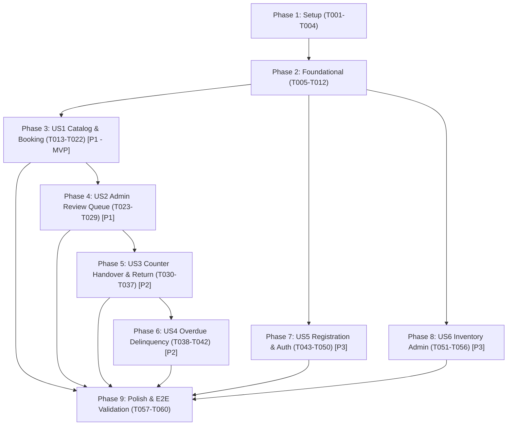

# Tasks: BorrowHub Equipment Borrowing Management UI/UX Platform

**Input**: Design documents from `/specs/001-equipment-borrowing-ui/` (`spec.md`, `plan.md`, `data-model.md`, `contracts/api-endpoints.md`, `quickstart.md`, `research.md`)  
**Prerequisites**: `plan.md` (required), `spec.md` (required for user stories), `data-model.md`, `contracts/`  
**Constitution Alignment**: Adheres to BorrowHub Constitution Principles I (Quality & Simplicity), II (Testing Discipline), IV (Transactional Integrity & Row Locking), and V (Observability).

## Format: `[ID] [P?] [Story] Description`
- **[P]**: Can run in parallel (different files, no incomplete dependencies)
- **[Story]**: Associated user story (e.g. `[US1]`, `[US2]`, `[US3]`, `[US4]`, `[US5]`, `[US6]`)
- Every task includes an exact file path.

---

## Phase 1: Setup (Shared Infrastructure)

**Purpose**: Initialize Next.js 15, TypeScript, Tailwind CSS, shadcn/ui base, Prisma ORM, and testing environments.

- [X] T001 Initialize Next.js 15 project structure with TypeScript and ESLint in `package.json` and `tsconfig.json`
- [X] T002 [P] Configure Tailwind CSS with 8pt spacing grid and Arabic typography fonts (`IBM Plex Sans Arabic`, `Cairo`, `Inter`) in `tailwind.config.ts` and `src/app/globals.css`
- [X] T003 [P] Configure Vitest test runner and Playwright E2E configuration in `vitest.config.ts` and `playwright.config.ts`
- [X] T004 Setup environment variables schema and validation using Zod in `src/lib/env.ts`

---

## Phase 2: Foundational (Blocking Prerequisites)

**Purpose**: Core infrastructure, database schemas, atomic transaction helpers, and layout components that MUST be complete before any user story can be implemented.

**⚠️ CRITICAL**: No user story work can begin until this phase is complete.

- [X] T005 Define Prisma schema for `User`, `Category`, `Equipment`, `Loan`, and `DamageRecord` with enums and indexes in `prisma/schema.prisma`
- [X] T006 Implement database client instance with logging and transaction support in `src/lib/db/prisma.ts`
- [X] T007 [P] Create initial database seed script with categories, sample equipment, and admin/student test users in `prisma/seed.ts`
- [X] T008 [P] Implement session management and JWT authentication utilities with cookie helpers in `src/lib/auth/session.ts`
- [X] T009 [P] Implement internationalization / directionality state provider for instant Arabic RTL / English LTR flipping in `src/components/layout/DirectionProvider.tsx`
- [X] T010 [P] Build core UI primitives (Button, Input, Dialog/Modal, Badge, Card, Skeleton) following WCAG 2.1 AA in `src/components/ui/`
- [X] T011 Build responsive navigation header with language switcher and dynamic student/admin sidebar in `src/components/layout/Header.tsx` and `src/components/layout/Sidebar.tsx`
- [X] T012 Implement root application layout applying dynamic `dir="rtl"` / `dir="ltr"` and direction provider in `src/app/layout.tsx`

**Checkpoint**: Foundation ready — user story implementation can now begin.

---

## Phase 3: User Story 1 - Equipment Discovery & Booking Request (Priority: P1) 🎯 MVP

**Goal**: Students can browse the equipment catalog (`SCR-04`), inspect equipment details (`SCR-05`), submit a loan request (≤ 10 days, max 2 active loans quota) via booking modal (`SCR-04-M`), and track or self-cancel pending requests on their portal (`SCR-03`).

**Independent Test**: An authenticated student with an `ACTIVE` account can view catalog items, apply filters, open the request dialog, submit a loan with justification and duration (1–10 days), verify it appears under `SCR-03` with status `PENDING_REVIEW`, and test 1-click self-cancellation.

### Tests for User Story 1
- [X] T013 [P] [US1] Unit tests for loan booking duration rules (1–10 days), quota check (max 2 active), and self-cancel validation in `tests/unit/loan-service.test.ts`
- [X] T014 [P] [US1] Integration tests for catalog listing and booking API endpoints in `tests/integration/catalog-booking.test.ts`

### Implementation for User Story 1
- [X] T015 [P] [US1] Implement `LoanService` methods (`createBookingRequest`, `getStudentLoans`, `selfCancelRequest`) in `src/services/loan.service.ts`
- [X] T016 [P] [US1] Implement Equipment Catalog API endpoint with search and category filtering in `src/app/api/v1/equipment/route.ts`
- [X] T017 [US1] Implement Loan submission and self-cancellation API endpoints in `src/app/api/v1/loans/route.ts` and `src/app/api/v1/loans/[id]/cancel/route.ts`
- [X] T018 [P] [US1] Build responsive equipment catalog card with live availability indicators in `src/components/catalog/EquipmentCard.tsx`
- [X] T019 [P] [US1] Build booking modal dialog (`SCR-04-M`) with 1–10 day duration stepper and academic purpose textarea in `src/components/catalog/BookingDialog.tsx`
- [X] T020 [US1] Implement Equipment Catalog page (`SCR-04`) with multi-column grid, search, and category chips in `src/app/(student)/catalog/page.tsx`
- [X] T021 [US1] Implement Equipment Details page (`SCR-05`) with specs table and sticky reservation card in `src/app/(student)/catalog/[id]/page.tsx`
- [X] T022 [US1] Implement Student Loans Portal page (`SCR-03`) with KPI cards, active countdowns, and self-cancel trigger in `src/app/(student)/portal/page.tsx`

**Checkpoint**: User Story 1 delivers a fully functional, self-service student borrowing discovery and reservation MVP.

---

## Phase 4: User Story 2 - Lab Staff Review & Queue Processing (Priority: P1)

**Goal**: Warehouse/lab administrators can review pending loan requests on `SCR-06`, view applicant details and stock, approve with 1 click (atomically shifting stock from `available` to `reserved` and initiating a 48-hour pickup window), or reject with a mandatory explanation.

**Independent Test**: An administrator accesses `SCR-06`, approves a pending request, and verifies that `available_quantity` drops by 1 while `reserved_quantity` increases by 1 with a 48h deadline. Rejecting a request prompts for a reason and marks it `REJECTED` without altering stock.

### Tests for User Story 2
- [X] T023 [P] [US2] Unit test for atomic stock reservation (`SELECT ... FOR UPDATE`), 48h deadline computation, and rejection handling in `tests/unit/review-queue.test.ts`
- [X] T024 [P] [US2] Integration tests for admin approval, stock locking, and rejection endpoints in `tests/integration/admin-review.test.ts`

### Implementation for User Story 2
- [X] T025 [P] [US2] Implement atomic approval and rejection transactions in `src/services/loan.service.ts`
- [X] T026 [P] [US2] Implement 48-hour reservation expiration background sweeper helper in `src/lib/utils/expiration.ts`
- [X] T027 [US2] Implement Admin Review Queue API endpoints for approval and rejection in `src/app/api/v1/admin/loans/[id]/approve/route.ts` and `src/app/api/v1/admin/loans/[id]/reject/route.ts`
- [X] T028 [P] [US2] Build admin rejection dialog with mandatory reason validation in `src/components/admin/RejectDialog.tsx`
- [X] T029 [US2] Implement Admin Review Queue screen (`SCR-06`) with expandable student details and 1-click action buttons in `src/app/(admin)/admin/queue/page.tsx`

**Checkpoint**: User Story 2 completes the administrative reservation validation and atomic inventory allocation flow.

---

## Phase 5: User Story 3 - Counter Handover & Return Inspection (Priority: P2)

**Goal**: Counter administrators can confirm physical handovers (`CHECKED_OUT`) on `SCR-07`, handle loan duration extensions up to 10 days, and execute returns on `SCR-08` with either 1-click healthy returns (returning stock to `available_quantity`) or defect logging via damage modal (routing stock to `damaged_quantity`).

**Independent Test**: Hand over an approved item on `SCR-07` and confirm status updates to `CHECKED_OUT` with stock moving from `reserved` to `borrowed`. On `SCR-08`, perform a healthy return and verify stock increments `available_quantity`. On another item, submit a damage report and verify stock shifts to `damaged_quantity` with a linked `DamageRecord`.

### Tests for User Story 3
- [X] T030 [P] [US3] Unit tests for counter handover stock transition, extension ceiling (≤ 10 days cumulative), and damage logging in `tests/unit/counter-service.test.ts`
- [X] T031 [P] [US3] Integration tests for handover, healthy return, and damaged return API endpoints in `tests/integration/counter-operations.test.ts`

### Implementation for User Story 3
- [X] T032 [P] [US3] Implement `CounterService` methods (`checkoutHandover`, `returnHealthy`, `returnDamaged`, `extendLoanDuration`) in `src/services/counter.service.ts`
- [X] T033 [US3] Implement Counter API endpoints for checkout, returns, and extensions in `src/app/api/v1/admin/loans/[id]/checkout/route.ts`, `src/app/api/v1/admin/loans/[id]/return/route.ts`, and `src/app/api/v1/admin/loans/[id]/extend/route.ts`
- [X] T034 [P] [US3] Build Damage Inspection modal with severity selector and defect notes in `src/components/admin/DamageModal.tsx`
- [X] T035 [P] [US3] Build Counter Extension modal enforcing the 10-day cumulative limit in `src/components/admin/ExtensionModal.tsx`
- [X] T036 [US3] Implement Approved Pickups Counter screen (`SCR-07`) with 48h timers and 1-click handover in `src/app/(admin)/admin/pickups/page.tsx`
- [X] T037 [US3] Implement Returns & Inspection Counter screen (`SCR-08`) with 1-click healthy return and damage triggers in `src/app/(admin)/admin/returns/page.tsx`

**Checkpoint**: User Story 3 completes full physical counter operations and defect auditing.

---

## Phase 6: User Story 4 - Overdue Loans & Delinquency Tracking (Priority: P2)

**Goal**: Provide an alert dashboard (`SCR-09`) showing overdue loans past `expected_return_date`, highlighted with days overdue and direct student contact channels (phone/email), and enforce automatic borrowing blocks with instant reinstatement upon check-in.

**Independent Test**: Artificially age a loan past its return date, verify it surfaces prominently on `SCR-09` with overdue badges, verify the delinquent student cannot create new loans, execute the "Immediate Return" action on `SCR-09`, and confirm the student's booking privileges are immediately restored.

### Tests for User Story 4
- [X] T038 [P] [US4] Unit tests for real-time overdue detection, student booking block rule, and auto-reinstatement upon check-in in `tests/unit/overdue.test.ts`
- [X] T039 [P] [US4] Integration tests for Overdue dashboard API and immediate check-in action in `tests/integration/overdue-dashboard.test.ts`

### Implementation for User Story 4
- [X] T040 [P] [US4] Implement overdue query helpers and student eligibility checks in `src/services/loan.service.ts`
- [X] T041 [US4] Implement Overdue dashboard API endpoint with student contact details and days overdue in `src/app/api/v1/admin/overdue/route.ts`
- [X] T042 [US4] Implement Overdue Alerts Dashboard screen (`SCR-09`) with high-contrast alert badges, direct call/email links, and immediate return action in `src/app/(admin)/admin/overdue/page.tsx`

**Checkpoint**: User Story 4 enforces departmental asset recovery and automated borrowing policy compliance.

---

## Phase 7: User Story 5 - Student Registration & Role Verification (Priority: P3)

**Goal**: Enable prospective students to register via `SCR-02` with university credentials into `PENDING_APPROVAL` status, permit administrators to review and approve/reject accounts on `SCR-11`, and handle secure login via `SCR-01`.

**Independent Test**: Register a student on `SCR-02`, attempt login on `SCR-01` to observe the amber pending approval badge, log in as admin to approve the account on `SCR-11`, and verify the student can now authenticate and access the catalog.

### Tests for User Story 5
- [X] T043 [P] [US5] Unit tests for registration validation, password hashing, and account verification transitions in `tests/unit/account-service.test.ts`
- [X] T044 [P] [US5] Integration tests for registration, login, and admin user approval endpoints in `tests/integration/auth-verification.test.ts`

### Implementation for User Story 5
- [X] T045 [P] [US5] Implement `AccountService` methods (`registerStudent`, `authenticateUser`, `approveStudent`, `rejectStudent`) in `src/services/account.service.ts`
- [X] T046 [US5] Implement Auth API routes (register, login, logout) in `src/app/api/v1/auth/register/route.ts` and `src/app/api/v1/auth/login/route.ts`
- [X] T047 [US5] Implement Admin User Verification API endpoints in `src/app/api/v1/admin/users/route.ts` and `src/app/api/v1/admin/users/[id]/approve/route.ts`
- [X] T048 [P] [US5] Implement User Sign In screen (`SCR-01`) with role routing and pending alert banner in `src/app/(auth)/login/page.tsx`
- [X] T049 [P] [US5] Implement Student Registration screen (`SCR-02`) with 2-column grid and policy checkbox in `src/app/(auth)/register/page.tsx`
- [X] T050 [US5] Implement Student Account Verification screen (`SCR-11`) with tabbed pending/active/rejected tables and 1-click approvals in `src/app/(admin)/admin/users/page.tsx`

**Checkpoint**: User Story 5 completes secure onboarding and identity governance.

---

## Phase 8: User Story 6 - Inventory Catalog Management (Priority: P3)

**Goal**: Enable lab administrators to manage equipment items, categories, images, and total quantities on `SCR-10`, ensuring changes immediately propagate to the student catalog (`SCR-04` / `SCR-05`).

**Independent Test**: Admin navigates to `SCR-10`, adds a new equipment item with specifications and quantity counts, edits stock, and verifies that the new item appears instantly in the student catalog.

### Tests for User Story 6
- [x] T051 [P] [US6] Unit tests for equipment CRUD, non-negative quantity constraints, and aggregate stock conservation in `tests/unit/inventory-service.test.ts`
- [x] T052 [P] [US6] Integration tests for admin equipment creation and update endpoints in `tests/integration/inventory-crud.test.ts`

### Implementation for User Story 6
- [x] T053 [P] [US6] Implement `InventoryService` methods (`createEquipment`, `updateEquipment`, `archiveEquipment`) in `src/services/inventory.service.ts`
- [x] T054 [US6] Implement Admin Inventory CRUD API routes in `src/app/api/v1/admin/inventory/route.ts` and `src/app/api/v1/admin/inventory/[id]/route.ts`
- [x] T055 [P] [US6] Build equipment modal form (`SCR-10-M`) for adding and editing gear with image URL and quantity inputs in `src/components/admin/EquipmentFormDialog.tsx`
- [x] T056 [US6] Implement Inventory Management screen (`SCR-10`) with aggregate KPI cards and stock edit tables in `src/app/(admin)/admin/inventory/page.tsx`

**Checkpoint**: User Story 6 completes total equipment lifecycle upkeep and catalog management.

---

## Phase 9: Polish & Cross-Cutting Concerns

**Purpose**: System-wide accessibility audits, RTL/LTR mirroring validations, empty/error state illustrations, and end-to-end scenario verification.

- [X] T057 [P] Audit WCAG 2.1 AA color contrast and keyboard focus indicators across all 11 screens in `src/components/`
- [X] T058 [P] Implement responsive empty states and skeleton loaders for all catalog and admin tables in `src/components/shared/StatePlaceholders.tsx`
- [X] T059 Run Playwright E2E test suite covering Scenarios 1 through 6 from `quickstart.md` in `tests/e2e/quickstart-scenarios.spec.ts`
- [X] T060 Perform final codebase clean up, linting, and type check verification (`pnpm lint && pnpm typecheck`)

---

## Dependencies & Execution Order

### Parallel Execution Opportunities
- **Within Setup**: `T002`, `T003`, and `T004` can execute concurrently once `T001` initializes `package.json`.
- **Within Foundational**: Seed script (`T007`), session auth (`T008`), RTL provider (`T009`), UI primitives (`T010`), and navigation (`T011`) can proceed in parallel.
- **Across User Stories**: Once Foundational (Phase 2) is complete:
  - Developer A can build US1 (Catalog & Booking).
  - Developer B can build US5 (Registration & Verification) or US6 (Inventory Management).
- **Within US1**: Tests (`T013`, `T014`), Service (`T015`), and UI Components (`T018`, `T019`) can be authored concurrently.

---

## Implementation Strategy

### MVP First (Phases 1, 2, and 3)
1. Execute **Phase 1: Setup** and **Phase 2: Foundational**.
2. Execute **Phase 3: User Story 1 (Equipment Discovery & Booking Request)**.
3. **Validate**: Students can register, browse equipment in Arabic RTL, and submit loan requests within 10 days and 2-loan quota.
4. **Deploy / Demo MVP**.

### Incremental Feature Additions
1. Add **Phase 4: US2 Review Queue** → Enables lab staff to approve requests and atomically reserve stock.
2. Add **Phase 5: US3 Counter Operations** → Enables physical handovers, healthy check-ins, and defect logging.
3. Add **Phase 6: US4 Overdue Dashboard** → Enforces 10-day return enforcement and automatic eligibility blocks.
4. Add **Phase 7: US5 Account Governance** & **Phase 8: US6 Inventory Upkeep**.
5. Finalize with **Phase 9: Polish & Cross-Cutting Concerns**.
